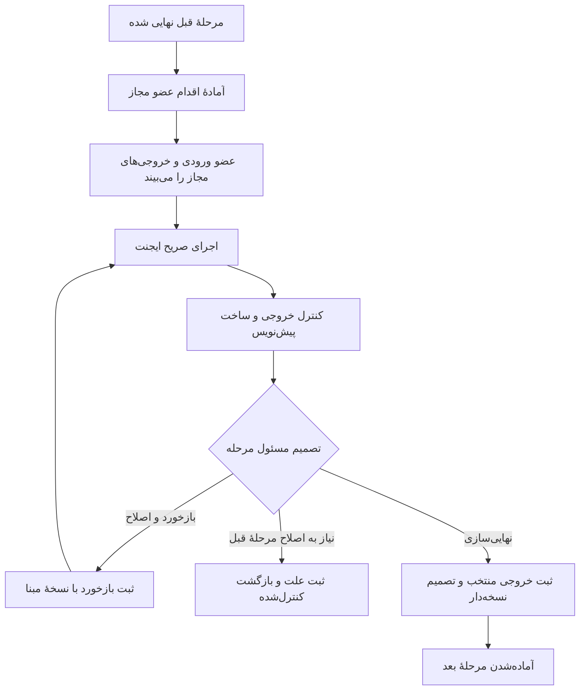

# مدل کارکرد Kara و اجرای تیمی فرایندهای توسعه

نسخهٔ ۰٫۴ — ۲۱ اکتبر ۲۰۲۶ — مرجع نیازمندی و طراحی برای پیاده‌سازی بعدی.

این سند توضیحات مستقیم مالک پروژه و پاسخ او دربارهٔ مدیریت دسترسی را ثبت می‌کند. بخش «تصمیم‌های کاربر» نیازمندی مصوب این گفتگو است؛ موجودیت‌ها، وضعیت‌ها و جزئیات اجرایی، طرح پیشنهادی پیاده‌سازی‌اند و تا زمان ساخت و آزمون، قابلیت موجود محسوب نمی‌شوند. طبق تصمیم تکمیلی، ابتدا [آمادگی و تکمیل بستر Kara](kara-platform-readiness-plan.md) انجام می‌شود؛ سپس [برنامهٔ ایجنت‌های کلاسور](clasor-agents-implementation-plan.md) اجرا می‌شود.

وضعیت اجرایی به‌روز در [برنامهٔ آمادگی](kara-platform-readiness-plan.md) است: تا KP-06 از جمله [کارتابل و تحویل](kara-team-inbox.md) پیاده و آزمایش شده‌اند. جدول فاصله‌ها در ادامه، مبنای تاریخی بررسی اولیه است.

## ۱. هدف و محدوده

**کارا (Kara)** نام همین پروژه و محصول مشترک شرکت برای معرفی به تیم‌ها و کاربران است. کاربر نام پروژه را به Kara تغییر داده است. ادمین کل پروژه‌ها را ایجاد می‌کند؛ هر تیم در پروژهٔ خود چند فرایند و ایجنت دارد. هر درخواست با تصمیم PO به یک نسخهٔ مشخص از فرایند وارد می‌شود. اعضای مجاز، ایجنت مرحلهٔ خود را اجرا می‌کنند، با بازخورد به خروجی مطلوب می‌رسند و خروجی نهایی را به مرحلهٔ بعد تحویل می‌دهند.

مبنای فنی upstream پروژه Dify است؛ نام آن در جزئیات فنیِ لازم مانند نسخه و وابستگی ذکر می‌شود. موتور اجرا و قابلیت‌های همکاری تیمی، بخش‌های داخلی همان محصول Kara هستند.

کلاسور نخستین کاربرد اختصاصی این مدل است. استقرار آینده روی سرور پیش‌بینی شده است؛ انتخاب Kubernetes، ظرفیت و جزئیات استقرار در دامنهٔ فعلی نیست. این سند مجوز انتشار، استقرار یا اتصال تازه‌ای ایجاد نمی‌کند.

## ۲. تصمیم‌های مستقیم کاربر

| شناسه | تصمیم |
| --- | --- |
| U-01 | نام همین پروژه به «کارا / Kara» تغییر کرده و محصول با این نام معرفی می‌شود. نام Dify فقط در ارجاع فنیِ لازم به سورس upstream، نسخه و وابستگی‌ها باقی می‌ماند. |
| U-02 | ادمین کل پروژه‌ها را ایجاد و اعضای تیم و دسترسی آن‌ها به پروژه را تعیین می‌کند. |
| U-03 | هر تیم فرایند خودش را می‌سازد؛ یک پروژه می‌تواند چند فرایند داشته باشد. |
| U-04 | ورودی اولیه دستی یا Jira است؛ افزودن Git issue و منابع دیگر در آینده ممکن باشد. |
| U-05 | PO ورود درخواست به تولید را تأیید و فرایند اجرای آن را انتخاب می‌کند. |
| U-06 | هنگام تعریف ایجنت مشخص شود چه کاربران پروژه مجاز به اجرای آن هستند؛ یک ایجنت می‌تواند چند مجری مجاز داشته باشد. |
| U-07 | هر فرد، ایجنت مرتبط با نقش خود را با خروجی مرحلهٔ قبلی اجرا می‌کند و می‌تواند چندین بار بازخورد بدهد. |
| U-08 | مراحل با تحویل خروجی نهایی پیش می‌روند؛ هدف، پشتیبانی از این همکاری و اتوماسیون قواعد فرایند است. |
| U-09 | طبق پاسخ تکمیلی، ادمین کل و مدیر پروژه هر دو مجاز به تنظیم دسترسی ایجنت‌های همان پروژه‌اند. |
| U-10 | پس از شروع پیاده‌سازی، ایجنت‌های اختصاصی کلاسور و دارایی‌های مرتبط در شاخهٔ دقیق `clasor-agents` کامیت شوند. |
| U-11 | محیط مورد نظر همین نسخهٔ محلی است و در زمان این بررسی خاموش است. |
| U-12 | ابتدا امکانات و فاصله‌های خود Kara بررسی و بستر لازم برای استفادهٔ تیمی آماده شود؛ ساخت ایجنت‌های اختصاصی کلاسور پس از آن انجام شود. |
| U-13 | بررسی‌ها و برنامه‌ریزی‌های فعلی به master منتقل شوند؛ clasor-agents فعلاً هم‌سطح master و بدون کامیت اختصاصی باشد. |

قواعد قبلیِ سازگار حفظ می‌شوند: تأیید نیازمندی از اقدام واقعی PO دریافت شود؛ نتیجهٔ گفت‌وگوی فنی به نسخهٔ بسته وصل باشد؛ تأیید و مرج کد دستی با TL است. ادمین کل، مدیر پروژه و PO می‌توانند یک شخص باشند، اما اختیاراتشان جدا تعریف می‌شود.

## ۳. نتیجهٔ بررسی پروژهٔ فعلی

مبنای کد: `clasor-analysis-agents` در commit `9fdaa983a1711bc3b9c422005748ba3ef61c50cc`، شامل `agents` تا `57c7e86` و بستر `master` تا `814b074`. این مبنای تاریخیِ بررسی اولیه است. طبق اصلاح بعدی کاربر، کامیت‌های همین گفتگو به `master` منتقل و `clasor-agents` با شاخهٔ اصلی هم‌سطح می‌شود؛ تاریخچهٔ قدیمی روی شاخه‌های پیشین می‌ماند. تغییر شاخهٔ Git داده و برنامه‌های Kara را جدا نمی‌کند.

| بخش | آنچه در کد/مستند فعلی دیده شد | فاصله با مدل مورد نیاز |
| --- | --- | --- |
| پروژه‌ها | فضای کاری مستقل، مالک، اعضا، مدل و دانش؛ [راهنما](projects.md)، `access.py` و `ownership.py` | پایه قابل استفاده است؛ نقش‌های کسب‌وکاری پروژه باید افزوده شوند. |
| مدیریت سراسری | یک حساب نصب در `company_product` با نام فنی `is_product_owner` | این حساب در مدل جدید «ادمین کل Kara» است؛ با PO تیم اشتباه نشود. تغییر عنوان رابط و سازگاری API، کار مستقل بستر است. |
| اعضا و نقش‌ها | نقش‌های بومی owner/admin/editor/normal و کنترل سمت سرور؛ [مالکیت](project-ownership.md) | در Community هر عضویت یک نقش بومی دارد؛ PO/TL/Designer/Developer/QC و مجوز اجرای هر ایجنت، با این نقش‌ها یکی نیستند. |
| ویرایش و اجرای برنامه | فهرست/مدیریت برنامه با مجوز بومی و شاخهٔ Enterprise RBAC | در افزونهٔ فعلی، سیاست اختصاصی چندکاربره برای اجرای هر ایجنت و نهایی‌سازی هر مرحله تعریف نشده است. |
| کارتابل | WorkflowRun و فرم انسانیِ متصل به حساب؛ [راهنما](project-inbox.md)، `inbox.py` و `approval.py` | صف «مرحلهٔ آمادهٔ اقدام من»، حلقهٔ بازخورد و تحویل خروجی نهایی بین ایجنت‌های مستقل هنوز ساخته نشده است. |
| حریم خروجی | عضو عادی عمدتاً اجرای خودش و فرم تعیین‌شده را می‌بیند؛ محتوای اجرای دیگر در اختیارش قرار نمی‌گیرد | نفر مرحلهٔ بعد به خروجی مجاز و منتخب نیاز دارد؛ نباید برای این نیاز، دسترسی ویرایش همهٔ برنامه‌ها بگیرد. |
| اتوماسیون | زمان‌بندی/رویداد بومی و کپی مستقل Workflow؛ [راهنما](project-automations.md) | اجرای زمان‌بندی‌شده با حساب مالک پروژه، جای هویت مجری مرحله یا تصمیم PO را نمی‌گیرد. |
| ایجنت‌های موجود | قالب پایه، تحلیل/بررسی/برنامه‌ریز کلاسور و دستور نقش‌های PA | قالب پایه trial و خروجی آن محدود به status/result/questions است؛ حلقه و قرارداد جدید به تطبیق نیاز دارند. |
| تحلیل محصول | یک هماهنگ‌کننده و هشت نقش تخصصی، [طرح](https://github.com/Mahyar1990/Kara/blob/57c7e861160d037493817098090efbc467807b9a/docs/product-analysis-lifecycle.md) و [برنامهٔ قبلی](product-analysis-implementation-plan.md) | این مجموعه تنها بخش تحلیل چرخه است؛ طراحی UI، توسعه، اجرای QC و پذیرش نهایی هم لازم‌اند. |
| ورودی Jira | در برنامهٔ قبلی توسعهٔ محلی بر پاسخ سرویس واسط متکی است | بدون نمونهٔ واقعی پاسخ، نام فیلدها و نگاشت Jira حدس زده نشوند؛ ورودی دستی پیش می‌رود. |
| هویت محصول | طبق توضیح کاربر، نام همین پروژه به Kara تغییر کرده و محصول با همین نام معرفی می‌شود | معرفی، راهنما و برنامهٔ توسعه با نام Kara هماهنگ شوند؛ بررسی زندهٔ رابط به روشن‌شدن محیط وابسته است. |

`make status` و `make doctor` به علت نبود Docker socket محلی موفق نشدند؛ `localhost:8080` نیز پاسخ نداد. پس از پاسخ کاربر مبنی بر خاموش بودن محیط، سرویس‌ها روشن نشدند. برنامه‌های فعلی بانک داده، نشست‌ها، مدل و نسخه‌های منتشرشده بررسی زنده نشده‌اند. این نتیجه دربارهٔ درستی تغییرات ذخیره‌شده در استودیو قضاوت نمی‌کند.

## ۴. تفکیک اختیارها

| نقش | اختیار و مسئولیت |
| --- | --- |
| ادمین کل Kara | ساخت پروژه، تعیین مدیر پروژه و مدیریت دسترسی؛ تصمیم کسب‌وکاری یک نیازمندی از این عنوان استنتاج نشود. |
| مدیر پروژه | مدیریت تیم در محدودهٔ پروژه و تنظیم مجوز ایجنت‌ها؛ به‌تنهایی PO یا TL محسوب نشود. |
| PO پروژه | تصمیم ورود درخواست، انتخاب فرایند، تأیید نیازمندی و پذیرش محصول برای نسخهٔ مشخص. |
| TL پروژه | هدایت برنامه‌ریزی و بررسی فنی، تصمیم و مرج دستی کد. |
| Designer | اجرای طراحی و اصلاح خروجی طبق بازخورد. |
| Developer | اجرای پیاده‌سازی و رفع یافته‌ها با ابزار مجاز. |
| QC | اجرای بررسی کیفیت، تست و ثبت شواهد و ایراد. |

این نقش‌های کسب‌وکاری می‌توانند برای یک حساب در پروژه ترکیب شوند. نقش بومی Kara برای استفاده/ویرایش منابع، لایهٔ جداست. «اجازهٔ اجرای ایجنت» نباید کاربر را editor همهٔ پروژه کند.

### الگوی اولیهٔ مجوز نقش‌ها

| ایجنت/مرحله | مجری اصلی طبق توضیح کاربر | مجریان اضافه با تنظیم پروژه |
| --- | --- | --- |
| کشف و اعتبارسنجی | PO | کاربران منتخب پروژه |
| محدودهٔ نسخهٔ اول | PO | کاربران منتخب پروژه |
| تحلیل نیازمندی | PO | کاربران منتخب پروژه |
| طراحی | UI/UX Designer | PO، TL، Developer یا افراد منتخب |
| برنامه‌ریزی | TL | PO یا افراد منتخب |
| پیاده‌سازی | Developer | PO، TL یا افراد منتخب |
| بررسی کیفیت | QC | PO، TL یا افراد منتخب |
| پذیرش | PO | افراد منتخب با اختیار پذیرش صریح |

این جدول الگوی پیشنهاد هنگام تنظیم پروژه است؛ عنوان شغلی داخل prompt، مجوز نمی‌سازد. تصمیم نهایی بر اساس شناسهٔ حساب‌های انتخاب‌شده و سیاست ثبت‌شدهٔ همان پروژه بررسی می‌شود. کاربر می‌تواند مجری اضافه تعیین کند؛ انتخاب مجری اضافه، حق تأیید نیازمندی، پذیرش یا مرج را خودکار به او نمی‌دهد.

## ۵. قرارداد پیشنهادی مجوز

اختیارهای `view`، `run`، `feedback`، `finalize`، `edit_definition`، `publish_definition` و `manage_access` جدا باشند. انتخاب مجریان در فرم ساده می‌تواند run/feedback را یکجا بدهد؛ finalize و اختیار تصمیم باید مستقل و روشن ثبت شوند. ادمین کل و مدیر پروژه manage_access دارند؛ تصمیم کسب‌وکاری همچنان به مسئول تعیین‌شده تعلق دارد.

اجرای مجاز در یک مرحله نیازمند همهٔ این شروط است: حساب فعال، عضویت فعلی همان پروژه، مجوز ایجنت، اجازهٔ اقدام در همان مرحله و برقرار بودن پیش‌نیازها. نسخهٔ ورودی و ایجنت و فرایند نیز باید با پرونده تطبیق داشته باشند. نقش سراسری، پارامتر user_id در درخواست یا ادعای مدل جای هویت نشست را نگیرد.

کنترل در سرور روی شروع، ادامه، بازخورد، نهایی‌سازی و دریافت artifact انجام شود. مسیر اجرای بومی، دیباگ، وب‌اپ منتشرشده، Service API و زمان‌بندی نیز بررسی شوند تا مسیر جایگزین سیاست را دور نزند. برای ایجنت تحت کنترل تیم، مسیر عمومیِ فاقد هویت معتبر یا باید بسته باشد یا از درگاه کنترل‌شده عبور کند. کلید سرویس، مجوز جعل نقش انسان نیست.

با حذف عضویت یا مجوز، اقدامات تازه و نهایی‌سازی رد شوند. اجرای در حال انجام در صورت پشتیبانی متوقف شود؛ در غیر این صورت خروجی فقط سابقهٔ اجراست و بدون بررسی دوبارهٔ مجوز تحویل نمی‌شود. تعویض مسئول مرحله و هر دسترسی مدیریتی به محتوا، رویداد قابل پیگیری داشته باشد.

## ۶. موجودیت‌های پیشنهادی

این فهرست قرارداد مفهومی است؛ نام جدول و API قطعی نمی‌کند.

| موجودیت | دادهٔ ضروری |
| --- | --- |
| ProjectMembership / BusinessRole | حساب، پروژه، نقش‌های کسب‌وکاری و وضعیت؛ متصل به حساب بومی Kara |
| AgentDefinition / AgentVersion | نقش، دستور، schema، ابزارها و محدودیت، نسخهٔ ثابت و برنامهٔ اجرایی متناظر در Kara |
| AgentGrant | پروژه، ایجنت، حساب، اقدام‌های مجاز، اعطاکننده و زمان؛ حساب باید عضو همان پروژه باشد |
| FlowDefinition / FlowVersion | مراحل، ایجنت و نسخهٔ هر مرحله، وابستگی، قواعد ورود/بازگشت/نهایی‌سازی |
| Requirement / RequirementRevision | شناسهٔ داخلی، متن اصلی، نسخه، محصول، منبع، پیوست و ابهام‌ها |
| IntakeDecision | PO، تصمیم و زمان، نسخهٔ دقیق درخواست و FlowVersion منتخب |
| FlowInstance | یک پروندهٔ اجرا برای درخواست، نسخهٔ درخواست، نسخهٔ فرایند و وضعیت جاری |
| StageInstance | مرحله، مسئول، مجوزها، ورودی‌های دقیق، وضعیت و شمارهٔ بازبینی |
| AgentAttempt | یک اجرای فنی Kara، اجراکننده، شناسهٔ WorkflowRun، نسخهٔ prompt/مدل، زمان و نتیجه |
| FeedbackTurn | متن بازخورد/پاسخ، نویسنده، نسخهٔ مبنا و ارتباط با تلاش قبلی |
| ArtifactRevision | نوع خروجی، محتوای نسخه‌دار، هش، منابع و وابستگی به خروجی‌های قبلی |
| StageDecision | خروجی منتخب، حساب نهایی‌کننده، تصمیم، توضیح و زمان |
| AuditEvent | اقدام، عامل واقعی، حساب سرویس در صورت وجود، پروژه، مرجع، نسخه و نتیجه |

یک مرحله می‌تواند چند تلاش و چند بازخورد داشته باشد. یک WorkflowRun معادل کل درخواست یا پایان مرحله نیست. موفقیت موتور اجرای مدل با تأیید محتوای خروجی متفاوت است.

## ۷. دریافت درخواست و انتخاب فرایند

ورودی دستی و مبدل Jira به قرارداد داخلی مشترک تبدیل شوند: پروژه، عنوان، متن اصلی، منشأ، شناسه/لینک بیرونی در صورت وجود، پیوست‌ها و زمان دریافت. متن اصلی و متن اصلاح‌شده جدا بمانند. دادهٔ ناقص قابل ثبت است و با پرسش روشن تکمیل می‌شود.

دسترسی محلی فعلی به Jira مفروض نیست. مطابق برنامهٔ قبلی، نمونهٔ پاسخ سرویس واسط از کاربر دریافت و پالایش می‌شود؛ قرارداد آن با پاسخ بومی Jira یکی فرض نمی‌شود. تا دریافت آن، مبدل واقعی ساخته نمی‌شود و نمونهٔ دستی برای ادامه کافی است.

ورودی تکراری با کلید منبع/سامانه/شناسهٔ بیرونی در همان پروژه تشخیص داده شود. دریافت نسخهٔ جدید درخواست، پروندهٔ اجرا و تأیید قبلی را بی‌صدا بازنویسی نکند. دریافت خودکار می‌تواند پیش‌نویس بسازد؛ ورود به فرایند نیازمند تصمیم PO است.

PO درخواست و نسخهٔ منتشرشدهٔ یکی از فرایندهای همان پروژه را انتخاب و تأیید ورود را ثبت می‌کند. تأیید ورود یعنی مجوز آغاز تحلیل/تولید طبق آن فلو؛ اگر معیارهای پذیرش هنوز تهیه نشده‌اند، تأیید نهایی نیازمندی در مرحلهٔ تحلیل جدا انجام می‌شود. فلوهای کوتاه می‌توانند از نیازمندی از پیش مصوب استفاده کنند، مشروط به پیوند همان نسخه و تصمیم معتبر.

## ۸. تعریف و نسخه‌بندی فلو

هر پروژه چند FlowDefinition دارد؛ مثلاً توسعهٔ قابلیت، رفع باگ و کشف محصول. نسخهٔ منتشرشده از draft جداست. پرونده به FlowVersion و AgentVersionهای همان نسخه متصل است. تغییر تعریف، اجرای جاری را خودکار به نسخهٔ تازه نبرد؛ مهاجرت فقط با اقدام صریح، بررسی اثر و ثبت تاریخچه انجام شود.

در نسخهٔ اول، ترتیب مراحل عمدتاً خطی و بازگشت‌ها صریح باشند. حذف مرحلهٔ نامرتبط باید از تعریف نسخهٔ فرایند یا تصمیم مجاز همراه دلیل بیاید. اجرای هم‌زمان شاخه‌ها پس از اثبات چرخهٔ ساده افزوده شود. هیچ مسیر کوتاه نباید تصمیم الزامی PO، کیفیت لازم یا مرج دستی TL را دور بزند.

«هر تیم فلو خودش را می‌سازد» یعنی تیم می‌تواند نقش‌ها و ترتیب قابل پشتیبانی را پیکربندی کند. افزودن نوع ابزار، مجوز تازه یا اجرای فرمان خارج از دامنهٔ تعریف‌شده، توسعهٔ مستقل بستر/اتصال است.

## ۹. چرخهٔ تعاملی هر مرحله

Kara خروجی نهایی مرحلهٔ قبل را خودکار به ورودی مجاز مرحلهٔ بعد متصل می‌کند. نفر مرحلهٔ بعد خودش «اجرا» را انتخاب می‌کند. آماده‌کردن مرحله و کارتابل، اجرای مدل با هویت او نیست. بستن مرحله نیازمند اقدام finalize و شروط تعریف‌شدهٔ آن است؛ آخرین پاسخ مدل خودکار نهایی نشود.

بازخورد می‌تواند به prompt مجدد یا ویرایش انسانیِ ثبت‌شده برسد؛ هر دو باید خروجی تازه با مرجع والد بسازند. سابقه حذف نشود. در بازخورد هم‌زمان، base_revision بررسی و تعارض آشکار شود؛ دو finalize هم‌زمان فقط یک تصمیم مؤثر ایجاد کنند. کلیک/رخداد تکراری با شناسهٔ یکتای اقدام، تلاش تکراری نسازد.

چرخهٔ بازخورد انسانی سقف ثابت و تحمیلی ندارد. زمان/هزینه و تعداد تلاش نمایش داده شوند؛ سقف فنی و سیاست ارجاع قابل تنظیم باشد. retry خودکار فقط برای خطای فنیِ قابل تکرار، با سقف مشخص و بدون تکرار اقدام بیرونی غیرقابل تکرار مجاز است.

### وضعیت‌های پیشنهادی مرحله

| وضعیت | معنی و اقدام |
| --- | --- |
| `blocked` | پیش‌نیاز، دسترسی یا اطلاعات مؤثر آماده نیست؛ علت و مسئول رفع مشخص شود. |
| `ready` | ورودی نهایی معتبر حاضر است؛ فرد مجاز می‌تواند شروع کند. |
| `running` | یک تلاش فنی فعال است؛ شروع تکراری کنترل شود. |
| `awaiting_feedback` | پیش‌نویس آمادهٔ بررسی و اصلاح انسان است. |
| `awaiting_decision` | خروجی برای تصمیم/نهایی‌سازی مسئول مربوط آماده است. |
| `completed` | خروجی مشخص با تصمیم معتبر نهایی شده است. |
| `failed` | تلاش فنی شکست خورده؛ مرحله خودکار تکمیل نمی‌شود. |
| `stale` | یکی از ورودی‌های مصرف‌شده تغییر کرده؛ خروجی تاریخی حفظ و تحویل جدید متوقف شود. |
| `cancelled` | با اقدام مجاز متوقف شده؛ علت و آثار باقی‌مانده ثبت شوند. |

این وضعیت‌ها بر وضعیت بومی WorkflowRun افزوده می‌شوند و جایگزین آن نیستند. رد/تعویق درخواست، انقضای فرم و نیاز به روشن‌سازی نیز در پرونده با تصمیم و علت جدا ثبت می‌شوند.

## ۱۰. خروجی مرحله و برگشت پس از تغییر

خروجی نهایی شامل هدف، محتوای تخصصی، پرسش‌ها/محدودیت‌ها، منابع، شناسهٔ درخواست و نسخه، مرحله، ایجنت و نسخه، خروجی‌های ورودی، نهایی‌کننده و زمان است. شناسه و مجوز و تصمیم از بستر بیاید؛ مدل فقط محتوا و پیشنهاد تولید می‌کند.

اگر خروجی قبلی عوض شود، وابستگی‌های مصرف‌کننده شناسایی و stale شوند. خروجی‌های گذشته حذف نشوند و فقط مراحل متأثر برای بررسی/بازاجرا برگردند. تغییر رفتار یا AC نیازمند تصمیم تازهٔ PO است. تغییر فنیِ بدون تغییر محصول به بررسی فنی برود. گزارش تست به commit کد، نسخهٔ تست و محیط/ترکیب نسخهٔ مربوط وصل باشد.

برای عضو عادیِ مرحلهٔ بعد، مجوز خواندن همان ArtifactRevisionهای مورد نیاز داده شود؛ دسترسی به تمام promptها، ورودی‌های خصوصی، اعتبارنامه‌ها و اجراهای دیگر از آن نتیجه نشود. این دسترسی برای ادامهٔ کار لازم است و در کارتابل فعلی هنوز باید پیاده شود.

## ۱۱. فلو مرجع کلاسور

| مرحله | مسئول شروع و اصلاح | خروجی نهایی / شرط تحویل |
| --- | --- | --- |
| دریافت و تأیید ورود | PO | درخواست نسخه‌دار، FlowVersion منتخب و تصمیم ورود |
| کشف/اعتبارسنجی و محدوده | PO | مسئله، شواهد/فرض‌ها، محدودهٔ نسخه؛ برای درخواست کوچک مسیر متناسب |
| تحلیل نیازمندی | PO | نیازمندی و AC شماره‌دار، رفع ابهام مؤثر و تصمیم واقعی PO |
| طراحی تجربهٔ کاربری | Designer و افراد مجاز | جریان کاربر، حالت‌های عادی/خالی/خطا و طرح مرتبط با AC |
| برنامه‌ریزی فنی | TL و افراد مجاز | تسک، وابستگی، مخزن/مبنا، روش تست و نتیجهٔ گفت‌وگوی واقعی تیم |
| پیاده‌سازی | Developer و افراد مجاز | تغییر کد، مستند لازم، گزارش بررسی و MRهای مرتبط |
| بررسی کیفیت | QC و افراد مجاز | تست واقعی، یافته‌های کد/رفتار و تطبیق با AC؛ ایراد به توسعه برگردد |
| تصمیم مرج و سندباکس | TL و مسئول استقرار تعیین‌شده | مرج دستی TL و ثبت ترکیب نسخهٔ مستقر |
| پذیرش | PO | ارزیابی شواهد و پذیرش/اصلاح/رد برای همان نسخهٔ سندباکس |
| انتشار و پایش | مسئول انتشار و PO طبق سیاست تیم | انتشار نسخه، امکان بازگشت و بازخورد عملیاتی؛ نقش اجرایی انتشار هنوز تعیین نشده است |

طراحی فنی در مسئولیت برنامه‌ریزی TL است؛ ایجنت طراحی UI جای آن را نمی‌گیرد. نقش‌های PA-01 تا PA-08 اجزای تخصصی تحلیل‌اند و لازم نیست هر کدام یک مرحلهٔ اجباری و قابل مشاهده برای همهٔ درخواست‌ها باشند. PA-00 تجمیع و پیشنهاد می‌کند؛ کنترل عبور در بستر انجام می‌شود. نویسندهٔ تست اجرایی و بازبین کد با PA-07 و PA-08 تحلیل یکی نیستند.

## ۱۲. مرز اتوماسیون

در نسخهٔ اول خودکار شوند: اعتبارسنجی، تشخیص تکرار، اتصال خروجی‌ها، آماده‌کردن اقدام بعدی، بررسی مجوز/نسخه، ثبت تاریخچه، تشخیص stale و retry فنی محدود. مسئول هر مرحله اجرا و اصلاح را هدایت می‌کند. تصمیم ورود، نهایی‌سازی، تأیید نیازمندی، پذیرش و مرج از اقدام واقعی افراد تعیین‌شده گرفته می‌شوند.

زمان‌بندی موجود برای دریافت تازهٔ درخواست یا کارهای دوره‌ایِ صریح مناسب است؛ فعال‌کردن آن جای مدل مرحله‌ای نیست. اجرای انسانی مرحلهٔ بعد به‌صورت پیش‌فرض خودکار نشود. هر اتوماسیون آینده هویت سرویس، دامنهٔ مجوز و صاحب تصمیم مستقل داشته باشد. اعلان/ایمیل فقط با کانال و مجوز انتخاب‌شدهٔ تیم متصل شود؛ این سند ارسال پیام ایجاد نمی‌کند.

## ۱۳. تجربهٔ مورد نیاز در Kara

- صفحهٔ درخواست‌ها: ورودی، منشأ، نسخه، تصمیم PO و انتخاب فرایند.
- صفحهٔ تنظیم فرایند: مراحل، نسخهٔ ایجنت‌ها، وابستگی‌ها و مسئول نهایی‌سازی.
- صفحهٔ دسترسی ایجنت: انتخاب اعضای همان پروژه و اقدام‌های مجاز؛ توسط ادمین کل/مدیر پروژه.
- کارتابل «اقدام‌های من»: مرحلهٔ آماده، نیازمند بازخورد، مانع و تصمیم منتظر من.
- صفحهٔ مرحله: ورودی معتبر، خروجی‌های قابل دسترسی، گفتگو/بازخورد، تلاش‌ها، هزینه/زمان و نهایی‌سازی.
- صفحهٔ پیگیری درخواست: وضعیت کل مسیر، مسئول فعلی، نسخه‌های مصرفی و علت برگشت.

متن محصول باید کار بعدی و وضعیت قابل فهم را نشان دهد؛ گزارش ساخت و آزمون و جزئیات مهاجرت در مستند توسعه باقی بمانند.

## ۱۴. تصمیم‌های باز و ترتیب رسیدگی

ساخت قرارداد و نمونهٔ آزمایشی به این تصمیم‌ها وابسته نیست. پیش از بهره‌برداری هر بخش، مورد مرتبط تعیین شود:

1. حساب‌های واقعی PO/TL/Designer/Developer/QC و مدیر پروژهٔ کلاسور و فرد نهایی‌کنندهٔ هر مرحله.
2. تأیید یا محدودکردن تفویض مدیریت اعضا به مدیر پروژه: کد فعلی اجازهٔ دعوت اعضا را به مالک پروژه می‌دهد؛ اختیار مدیریت مجوز ایجنت‌ها طبق پاسخ کاربر قطعی است.
3. نمونهٔ پالایش‌شدهٔ سرویس Jira برای ساخت مبدل واقعی؛ روش دریافت زنده بعداً تعیین شود.
4. مسئول استقرار سندباکس/انتشار و تعریف Done: پذیرش سندباکس، انتشار یا انتشار همراه پایش.
5. ابزار و محل اجرای توسعه/تست با دسترسی واقعی مخزن و شبکه؛ Kara به صرف داشتن مسیر فایل به VDI دسترسی ندارد.

## ۱۵. تقدم بر طراحی‌های قبلی

برای شیوهٔ استفاده، نقش‌های پروژه، دسترسی، بازخورد و تحویل مرحله، تصمیم‌های کاربر در این سند مبناست. [برنامهٔ تحلیل قبلی](product-analysis-implementation-plan.md) سابقه و جزئیات تخصصی مفید دارد؛ شاخهٔ `clasor-analysis-agents` در آن تاریخی است و فقط پیاده‌سازی آیندهٔ کلاسور روی `clasor-agents` ادامه می‌یابد؛ بررسی و برنامه‌ریزی فعلی روی `master` است. ترتیب هشت متخصص تحلیل الزام ترتیب کل چرخه نیست. قواعد نسخه، منابع sandbox و تصمیم انسانی قراردادهای قبلی تا جایی که با این نیازمندی‌ها سازگارند حفظ می‌شوند.
