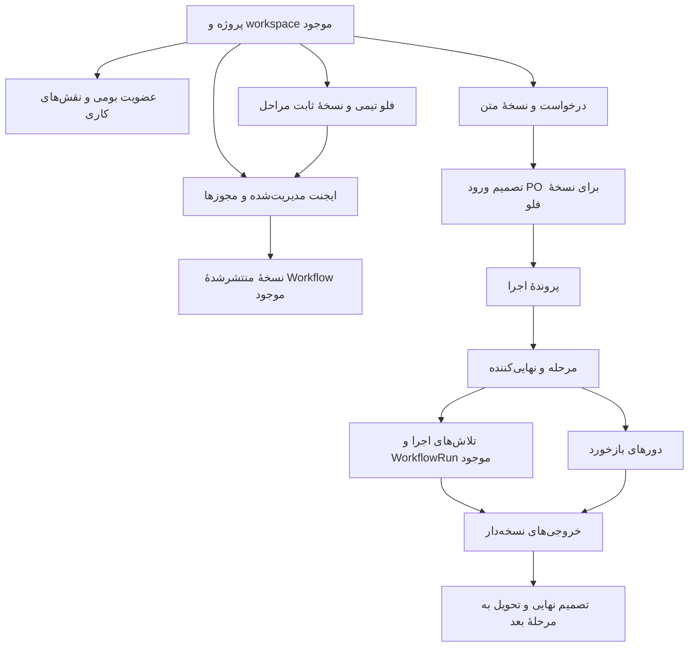

# مدل داده و طرح ارتقای همکاری تیمی Kara

نسخهٔ طراحی `1.0.0` — ۲۱ اکتبر ۲۰۲۶ — خروجی KP-00، همراه [قرارداد رفتاری](kara-team-contract-v1.md).

این سند مدل و ترتیب migrationها را تعیین می‌کند. خروجی KP-00 فقط طراحی بود. در KP-01، مهاجرت `001_team_roles` در `infra/api/company_projects/team_migrations.py` و آداپتر عضویت واقعی در `team.py` پیاده‌سازی و روی نسخهٔ بازیابی‌شدهٔ PostgreSQL آزموده شدند. جدول سیاست عضو برای revision و شناسهٔ عضویت نیز همراه نقش‌ها و audit ساخته می‌شود. مهاجرت‌های بعدی همچنان طراحی‌اند؛ جدول‌های آینده از پیش ساخته نمی‌شوند.

## ۱. مبنای موجود و تصمیم‌های سازگاری

مبنای کد شروع `58e744b` در `master` است. [ذخیره‌سازی پروژه](../infra/api/company_projects/store.py)، [عضویت/دسترسی](../infra/api/company_projects/access.py) و [مالکیت](../infra/api/company_projects/ownership.py) خوانده شدند. ساختار مدل‌های بومی accounts، tenant_account_joins، apps، workflows و workflow_runs از سورس نسخهٔ قفل‌شده بررسی شد؛ این بررسی در KP-00 مشاهدهٔ schema زنده نبود؛ شواهد ارتقای واقعی و بررسی محیط روشن اکنون در [گزارش KP-01](kara-kp01-validation.md) آمده‌اند.

**دو شناسهٔ tenant با هم مخلوط نشوند:** `company_projects.tenant_id` به فضای مدیریت مرکزی اشاره دارد؛ workspace واقعی تیم از `company_project_workspaces.workspace_id` گرفته می‌شود. عضویت، App.tenant_id و Workflow.tenant_id باید با workspace تیم تطبیق داشته باشند. Scope قرارداد از project_id و همین workspace_id ساخته می‌شود؛ tenant مرکزی جای workspace تیم نیست.

قواعد پایه:

- حساب و عضویت از ساختار بومی استفاده می‌کنند؛ جدول موازی رمز/نشست و مالک سراسری جدید ساخته نمی‌شود.
- مدیر پروژه از owner بومی همان workspace گرفته می‌شود؛ تغییر عنوان سراسری، دادهٔ `company_product` را بازانتخاب نمی‌کند.
- نقش کاری با یک عضویت می‌تواند چند مقدار داشته باشد؛ ستون role بومی بازنویسی نمی‌شود.
- Workflow منتشرشده و WorkflowRun موجود، مرجع اجرای فنی‌اند؛ FlowVersion تیمی مرجع ترتیب همکاری انسان‌هاست.
- نسخهٔ جدید فلو، پروندهٔ در حال اجرا را خودکار تغییر نمی‌دهد؛ برنامه‌های قدیمی نیز خودکار به فرایند تیمی تبدیل نمی‌شوند.
- برای ثبت واقعی، هویت از نشست سرور گرفته می‌شود؛ شناسهٔ حساب داخل ورودی کاربر صاحب رکورد را تعیین نمی‌کند.

## ۲. نقشهٔ روابط

## ۳. موجودیت‌ها و کلیدهای هدف

نام‌ها نام هدف برای پیاده‌سازی مرحله‌ای‌اند؛ ساخت یک‌بارهٔ همهٔ جدول‌ها لازم نیست. UUID و زمان‌های جدید با نوع سازگار بومی و UTC دارای timezone نگهداری شوند. زمان‌های naive موجود در موتور، هنگام خواندن با قرارداد UTC همان موتور تفسیر شوند؛ مقدار تاریخی با timezone لپ‌تاپ بازنویسی نشود.

| جدول هدف | دادهٔ ضروری و قید اصلی | گام ساخت |
| --- | --- | --- |
| `company_team_member_policies` | scope، account_id، membership_id و revision؛ قفل و تشخیص تغییر یا عضویت مجدد | KP-01 |
| `company_team_roles` | scope، account_id، business_role، assigned_by/at؛ یکتا روی scope/account/role؛ عضویت بومی همان workspace لازم است. | KP-01 |
| `company_team_agents` | id، scope، app_id، نام/توضیح، نسخهٔ قرارداد، lifecycle، acl_revision؛ هر ثبت متعلق به یک app همان workspace است. | KP-02 |
| `company_team_grants` | scope، agent_id، account_id، action، granted_by/at؛ یکتا روی scope/agent/account/action؛ manage_access در actionهای این جدول مجاز نیست. | KP-02 |
| `company_team_flows` | id، scope، نام، current_revision و وضعیت آرشیو؛ نام در همان پروژه یکتا باشد. | KP-03 |
| `company_team_flow_versions` | id، scope، flow_id، revision، digest، stage_bindings، published_by/at؛ نسخهٔ منتشرشده immutable است. | KP-03 |
| `company_team_requests` | id، scope، عنوان، منشأ و external_id اختیاری، created_by/at، current_revision؛ کلید بیرونی فقط در همان scope و سامانهٔ منبع یکتا باشد. | KP-04 |
| `company_team_request_revisions` | id، scope، request_id، revision، متن اصلی/متن نهایی، digest، parent، author؛ یکتا روی scope/request/revision؛ متن اصلی حفظ شود. | KP-04 |
| `company_team_intake_decisions` | id، scope، request_revision_id، flow_version_id، outcome/mode، actor، reason/time، expiry/revocation؛ مرجع و متن تصمیم immutable، ابطال رویداد مستقل داشته باشد. | KP-04 |
| `company_team_instances` | id، scope، request_revision_id، flow_version_id، intake_decision_id، وضعیت و زمان؛ هر سه مرجع به همان نسخه‌ها و پروژه تعلق داشته باشند. | KP-04/05 |
| `company_team_stages` | id، scope، instance_id، step_key، agent_id، workflow_id ثابت، record_revision، input_digest، state، finalizer_id، decision_role و active_attempt_id اختیاری | KP-05 |
| `company_team_attempts` | id، scope، stage_id، actor، input_digest و snapshot ورودی، workflow_id، workflow_run_id، mode/status/time؛ هر run بومی حداکثر به یک تلاش متصل شود. | KP-05 |
| `company_team_feedback` | id، scope، stage_id، author، base_revision، parent_artifact_id، متن/تغییر و input_digest جدید؛ append-only | KP-05 |
| `company_team_artifacts` | id، scope، stage_id، revision، parent، input_digest، digest، محتوا/مرجع فایل، نوع model/human و عامل واقعی؛ یکتا روی scope/stage/revision | KP-05 |
| `company_team_artifact_dependencies` | scope، consumer_artifact_id و producer_artifact_id؛ ارجاع به نسخهٔ دقیق خروجی و ممنوعیت وابستگی خارج پروژه | KP-06 |
| `company_team_stage_decisions` | id، scope، stage_id، base_revision، selected_artifact_id، input_digest، actor، outcome/reason/time؛ تصمیم مؤثر به همان ورودی تعلق دارد. | KP-05/06 |
| `company_team_action_keys` | scope، actor، operation، key، payload_digest، result_ref و وضعیت؛ تکرار payload متفاوت برای همان کلید تعارض است. | همراه اولین mutation لازم |
| `company_team_audit_events` | id، scope، actor یا service_principal واقعی، نوع اقدام، subject_ref، نسخه، زمان، correlation_id و نتیجه؛ append-only، بدون توکن و رمز | از KP-01 |
| `company_team_outbox` | id، scope، action_key، نوع کار، مرجع و payload حداقلی، وضعیت تحویل، retry/lease؛ یکتا روی رخداد منطقی | همراه اولین dispatch لازم |
| `company_team_migrations` | شناسهٔ migration، checksum و applied_at؛ ترتیب افزایشی و تغییرناپذیر | پیش از KP-01 |

برای حداقل‌بودن نسخهٔ اول، مراحل فلو و وابستگی‌های ساده در `stage_bindings` نسخهٔ فلو نگهداری می‌شوند؛ جدول مستقل stage template و موتور گراف دوم ساخته نمی‌شود. هر binding یک step_key پایدار، agent_id، workflow_id منتشرشده، digest قرارداد/تعریف، ورودی‌ها و قانون نهایی‌کننده دارد. انتشار با مرجع گم‌شده، مرحلهٔ تکراری، چرخه یا تصمیم‌گیرندهٔ نامشخص رد می‌شود.

نسخهٔ مستقل جدیدی برای کل Workflow کپی نمی‌کنیم. metadata اجرایی لازم با ارجاع به شناسهٔ Workflow منتشرشده و snapshot قرارداد در binding نگهداری می‌شود. هنگام ثبت instance، step_key و agent/workflow/finalizer به همان FlowVersion تطبیق داده می‌شوند؛ وجود JSON به‌تنهایی صحت رابطه را تضمین نمی‌کند.

## ۴. قواعد رابطه و جداسازی

1. هر رکورد جدیدِ مربوط به تیم scope دارد. رابطهٔ فرزند به والدِ افزونه با FK مرکب شامل scope و شناسهٔ والد محافظت شود؛ شناسهٔ معتبرِ پروژهٔ دیگر کافی نیست.
2. جدول موجود `company_project_workspaces` برای FK مرکب به UNIQUE(project_id, workspace_id) نیاز دارد. فقط همین قید افزودهٔ جدول متعلق به افزونه، پس از preflight، اضافه می‌شود؛ جدول‌های حساب/اجرای بومی بازطراحی نمی‌شوند.
3. tenant_account_joins از قبل UNIQUE(tenant_id, account_id) دارد؛ برای نقش و grant می‌توان به عضویت همان workspace ارجاع داد. حذف عضویت باید نقش/grant عملیاتی را حذف یا بی‌اثر کند و audit حذف را حفظ کند؛ تاریخچهٔ اجرا و تصمیم حذف نشود.
4. apps و workflows در منبع فعلی، PK شناسه دارند؛ فرض UNIQUE(id, tenant_id) برای آن‌ها نکنیم. FK ساده به id، جای بررسی scope را نمی‌گیرد. تعلق app/workflow/run به workspace و یکدیگر در تراکنش و مسیرهای تغییر/حذف منبع کنترل شود. حذف/انتقال منبعِ مصرف‌شده باید با سیاست آرشیو و خطای قابل فهم متوقف شود، نه حذف خام تاریخچه.
5. finalizer و مجریان باید عضو فعال همان پروژه باشند؛ چند حساب می‌توانند run داشته باشند، اما هر مرحله یک نهایی‌کنندهٔ مشخص دارد. نقش تصمیمِ لازم جدا ثبت می‌شود. تغییر مسئول، انتقال دسترسی artifactهای لازم و audit اتمی داشته باشد.
6. artifact به همان مرحله، ورودی و در حالت مدل، همان attempt متصل باشد؛ نوع human نویسندهٔ واقعی و والدِ اصلاح را نگه دارد. جدول روابط artifact فقط ارجاع نسخه‌هاست؛ محتوای خصوصی تکثیر عمومی نشود.
7. ارجاع instance به intake_decision باید درخواست، flow و نسخه‌های دقیق را نیز تطبیق دهد. پیاده‌سازی از قید مرکب روی کل tuple یا کنترل تراکنشی دارای قفل استفاده کند؛ FK شناسهٔ تصمیم به‌تنهایی کافی نیست.
8. binding فلو منتشرشده و artifact/feedback/decision تاریخی immutable باشند. تغییر متن، ورودی یا خروجی رکورد تازه می‌سازد؛ active pointer می‌تواند با کنترل نسخه عوض شود.
9. CHECKها حداقل revision مثبت، وضعیت/نوع معتبر، digest معتبر و سازگاری running با active_attempt_id را پوشش دهند. یک UNIQUE جزئی روی stage_id برای attempt فعال، همراه قفل/CAS مرحله استفاده شود؛ unique برابری NULL به‌تنهایی تک‌تلاشی را اثبات نمی‌کند.
10. برای نهایی‌سازی، UNIQUE(scope, stage_id, base_revision)، CAS روی record_revision و انتقال وضعیت/تصمیم/artifact/outbox در یک تراکنش لازم است. این قید مانع ثبت تصمیم تازه برای ورودی تازه نمی‌شود؛ تصمیم قبلی به ورودی جدید منتقل نشود.

شمارهٔ رکورد مرحله برای تعارض هم‌زمانی است؛ شمارهٔ خروجی برای تاریخچهٔ محتوا و workflow.version برای موتور است. این سه عدد به‌جای یکدیگر استفاده نشوند. نتیجهٔ لغوشده/قدیمی می‌تواند برای سابقهٔ فنی نگهداری شود، اما حق نهایی‌سازی و تحویل ندارد.

## ۵. مرز تراکنش‌ها

| اقدام | واحد اتمی لازم |
| --- | --- |
| تعیین نقش یا grant | بررسی حساب/عضویت، قفل سیاست مربوط، تغییر، افزایش revision و audit |
| انتشار فلو | اعتبارسنجی bindingها و مجوزها، ایجاد نسخهٔ immutable و تغییر pointer جاری |
| تأیید ورود | بررسی PO و نسخهٔ درخواست/فلو، ثبت تصمیم و ایجاد instance یا outbox شروعِ کنترل‌شده |
| شروع مرحله | بررسی مجدد مجوز/پیش‌نیاز، CAS مرحله، ساخت attempt و outbox؛ سپس dispatch از outbox |
| بازخورد | تطبیق base_revision، ثبت متن/والد، اتصال ورودی تازه و آماده‌سازی تلاش بعدی؛ اجرا خودکار نباشد. |
| نهایی‌سازی | بررسی مجوز/نهایی‌کننده/نسخه/خروجی، ثبت تصمیم، تکمیل مرحله و آماده‌سازی مرحلهٔ بعد |
| تغییر ورودی یا ابطال تصمیم | ثبت نسخه/رویداد، شناسایی مصرف‌کننده، stale کردن متأثرها و بستن تحویل تازه |

قفل مرحله، race با درخواست دوم را مدیریت می‌کند؛ race حذف عضویت/لغو grant نیز باید با snapshot مجوز و کنترل تراکنشی مربوط حل شود. outbox با تحویل دست‌کم یک‌باره و کلید تکرارپذیری طراحی شود؛ تطبیق با WorkflowRun و بازیابی attemptِ فاقد run_id لازم است. هیچ تضمین exactly-once از قرارداد آفلاین نتیجه نمی‌شود.

## ۶. طرح migration مرحله‌ای

`store.migrate` فعلی، company_project_schema را دقیقاً با مقدار ۱ می‌شناسد و از create_all استفاده می‌کند. create_all ساختار جدول موجود را ارتقا نمی‌دهد. برای قابلیت جدید، دفتر migration جدا `company_team_migrations` تعریف می‌شود؛ مقدار schema قدیمی صرفاً برای افزودن جدول‌های تیمی تغییر نمی‌کند.

| migration هدف | تغییر افزایشی | شرط پیش از اجرا |
| --- | --- | --- |
| `001_team_roles` | دفتر migration، قید scope در نگاشت پروژه، نقش‌های کاری و audit | نسخهٔ مبنا، نوع UUID، یکتایی نگاشت، وجود عضویت معتبر و پشتیبان قابل بازیابی |
| `002_team_agents_grants` | نقش‌های اجرایی و grantهای صریح، revision سیاست و action key لازم | hookهای حفاظت از تمام مسیرهای اجرای برنامهٔ تحت کنترل همراه schema در دسترس باشند. |
| `003_team_flows` | header و نسخهٔ فلوهای تیمی | قالب binding و ارجاع نسخهٔ منتشرشده تثبیت و آزموده شده باشد. |
| `004_team_requests` | درخواست، نسخه، تصمیم ورود و instance | قرارداد PO و مبدل دستی آماده باشد؛ Jira پیش‌نیاز نیست. |
| `005_team_sessions` | مرحله، تلاش، بازخورد، artifact و تصمیم مرحله | قرارداد گذار نسخهٔ ۱ و قیود scope پیاده و آزموده باشند. |
| `006_team_handoff` | وابستگی خروجی‌ها، قیود تکمیلی و outbox لازم | تحویل/مصرف نسخه و روش بازپخش تکرارپذیر آماده باشد. |

این نام‌ها ترتیب طراحی‌اند؛ هر فایل واقعی فقط تغییر لازم همان گام را انجام می‌دهد. audit/action_keys/outbox اگر زودتر لازم شدند همراه همان گام ساخته شوند، نه با dispatch بدون محافظت تا migration بعدی.

پروتکل runner آینده:

1. نسخه و checksum فایل‌ها، وضعیت schema فعلی و preflight را بررسی کند؛ نسخهٔ ناشناخته یا drift متوقف شود.
2. برای اجرای هم‌زمان API/worker یک advisory lock مشخص و ثابت بگیرد؛ فقط یک runner ارتقا دهد.
3. هر migration در تراکنش DDL PostgreSQL و همراه رکورد checksum اعمال شود؛ در خطا هم schema و هم marker rollback شوند.
4. اجرای مجددِ نسخهٔ دارای checksum یکسان no-op باشد؛ تغییر فایلِ اعمال‌شده با خطای صریح متوقف شود.
5. پیش از activation، قیود و شمارنده‌های مبنا و سابقهٔ فرم/اجرا دوباره تطبیق داده شوند؛ سپس قابلیت به‌صورت کنترل‌شده فعال شود.

ستون‌های فنی افزودهٔ احتمالی باید در خواندن نسخهٔ قبلی قابل تحمل باشند. پیش‌فرض migration برای نقش کاری و grant، **خالی** است؛ owner به‌صورت ضمنی PO نمی‌شود و normal/editor مجوز run همگانی نمی‌گیرند. برنامهٔ قدیمی بدون ثبت صریح، managed اعلام نمی‌شود. سابقهٔ WorkflowRun برای ساخت درخواست واقعی یا تأیید PO بازتفسیر نمی‌شود.

## ۷. بازگشت و بازیابی

پیش از migration واقعی، snapshot خصوصی PostgreSQL و فایل‌های لازم با روش موجود تهیه و restore در محیط جدا آزموده شود. پشتیبان وارد Git نمی‌شود. ارتقای schema نخست با قابلیت غیرفعال و بدون پذیرش درخواست تولیدی آزموده شود.

قبل از استفادهٔ managed agent، برگشت کد قبلی با نگهداری جدول‌های افزوده ممکن است، مشروط به تست سازگاری. پس از استفاده، برگشت به تصویری که سیاست جدید دسترسی را اجرا نمی‌کند می‌تواند مسیر اجرای بومی را دوباره باز کند؛ پایین‌آوردن نسخه بدون این بررسی مجاز نیست. مقصد rollback باید نسخهٔ سازگارِ دارای enforcement باشد، یا سرویس تا بازیابی کنترل‌شده متوقف بماند. خاموش‌کردن site/API به‌تنهایی بسته‌شدن اجرای استودیو را ثابت نمی‌کند.

برای بازگشت عادی جدول‌های تاریخچه drop نشوند و تصمیم واقعی پاک نشود. restore از backup عملیات جداست؛ نویسه‌ها/فایل‌ها و eventهای بعد از backup باید با برنامهٔ بازیابی بررسی شوند. retry اجرای migration به معنی بازاجرای Workflow یا تصمیم انسانی نیست.

## ۸. آزمون‌های الزامی هنگام ساخت migration

این موارد در KP-00 طراحی شدند. بخش مربوط به نقش‌های کاری در KP-01 اجرا شد؛ آزمون‌های موجودیت‌های آینده باید هنگام پیاده‌سازی همان گام اجرا شوند:

- ارتقا از schema ۱ روی PostgreSQL واقعی با حساب، دو پروژه، عضویت، App، WorkflowRun و فرم منتظر ساختگی؛ شمار، شناسه، مالک و وضعیت قبلی حفظ شوند.
- اجرای دوباره، checksum متفاوت، نسخهٔ ناشناخته و اجرای هم‌زمان دو runner؛ خطای عمدی میانهٔ migration نباید نیمه‌کار یا marker موفق باقی بگذارد.
- درج نقش/grant/artifact/decision با شناسهٔ معتبرِ پروژهٔ دیگر؛ قیود DB و آداپتر هر دو مسیرِ مربوط را رد کنند.
- حذف عضویت، آرشیو agent، حذف App و تغییر مسئول؛ مجوز جدید قطع و سابقهٔ تصمیم/اجرا قابل ردیابی باقی بماند.
- دو start و دو finalize هم‌زمان، callback تکراری/قدیمی، worker قطع‌شده، dispatch قبل/بعد commit و اتصال دوبارهٔ پایگاه.
- خواندن با نسخهٔ کد سازگارِ قبلی، بازگشت و restore در محیط مستقل، بدون پاسخ‌دادن به فرم واقعی یا فعال‌کردن اتوماسیون واقعی.

تست‌های SQLite موجود برای baseline مفیدند؛ رفتار FK/قفل/DDL/ایندکس جزئی PostgreSQL را اثبات نمی‌کنند. در KP-00 مهاجرت اجرا نشد. برای KP-01 اکنون ارتقای افزایشی، حفظ شناسه‌ها، نقش خالی، اجرای تکراری و هم‌زمان، checksum/نسخهٔ ناشناخته و rollback خطای DDL با PostgreSQL آزموده شده‌اند. قیود پروژه/عضویت، حذف عضو، audit و تعارض نقش نیز آزمون اجرایی دارند؛ سایر مدل‌ها به گام مربوط موکول‌اند.

## ۹. نتیجهٔ تحویل KP-00 و گام بعد

خروجی آفلاین: قرارداد رفتاری نسخهٔ ۱، مرجع مستقل، نمونه‌های ساختگی و ۳۳ آزمون جدید، مدل روابط و قیود و این طرح migration. `make check` با مجموع ۵۴ آزمون موفق است. پیکربندی Compose موجود نیز با config --quiet اعتبارسنجی شد؛ سرویسی شروع و مدلی فراخوانی نشد.

**به‌روزرسانی KP-01:** نقش‌های کاری و آداپتر حساب/عضویت واقعی همراه migration اول تحویل شدند. backup/restore، ارتقای بانک اصلی با حفظ ردیف‌های ۱۵۱ جدول قبلی، خواندن با کد قبلی، API، مرورگر و doctor آزموده شدند؛ [گزارش پذیرش](kara-kp01-validation.md) مرجع شواهد است. مدل/LLM در این گام اجرا نشد. دو مورد بازِ [بازبینی مجدد](kara-kp00-kp01-review.md)، نام محصول و تأیید ساخت استاندارد کلاینت، در [گزارش تکمیل](kara-kp01-closeout.md) بسته شدند. اکنون گام بعد KP-02 برای تعریف ایجنت قابل اجرا و مجوز صریح است. ورود به ساخت ایجنت‌های کلاسور تا پذیرش کل هسته انجام نمی‌شود.
