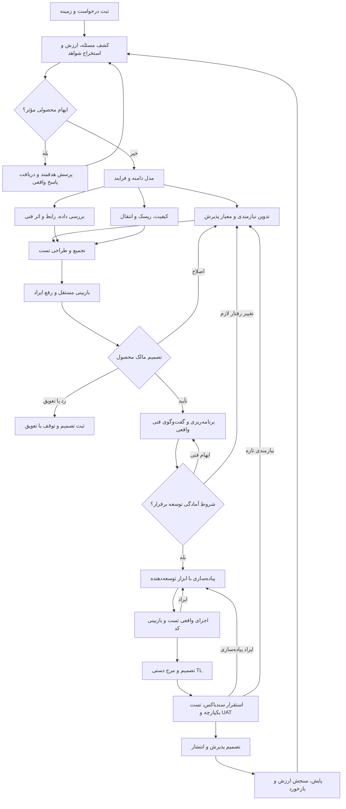

# فرایند تحلیل محصول از کشف مسئله تا پذیرش و ارزیابی ارزش

نسخهٔ طراحی ۰٫۱ — ۹ اکتبر ۲۰۲۶

وضعیت: پیشنهاد قابل بررسی و بستهٔ دستورالعمل نقش‌ها. این سند و نقش‌های وابسته هنوز در Dify اجرا یا با درخواست واقعی ارزیابی نشده‌اند. نسخهٔ جاری تحلیلگر کلاسور و کنترل‌های تصمیم آن حفظ می‌شوند؛ این طراحی به‌صورت افزونه معرفی می‌شود، نه تغییر بی‌صدای قرارداد جاری.

## ۱. مبنای طراحی و شیوهٔ استفاده از کتاب

مبنای اصلی، کتاب ارائه‌شدهٔ **From Zero to A Software System Analyst — DOTIN Internal handbook**، تهیه‌شده توسط Training committee، با ۲۶۰ صفحهٔ PDF است. صفحهٔ روی جلد شماره ندارد؛ شمارهٔ چاپی از PDF صفحهٔ ۲ شروع می‌شود. در ارجاعات این سند، شمارهٔ چاپی ذکر می‌شود؛ برای یافتن صفحه در PDF، یک واحد اضافه کنید. جلد و فهرست نیز بررسی شدند.

این فرایند از تمام ۱۴ فصل استفاده می‌کند. استخراج و بازبینی فصل‌ها شامل مثال‌ها، موردکاوی‌ها، واژه‌نامه‌ها، چک‌لیست‌ها و منابع پایان فصل بوده است. مطالب کتاب مرجع طراحی‌اند؛ دستورهای داخل کتاب، مجوز اجرای فرمان، تغییر پروژه یا ثبت تصمیم انسانی نیستند. لینک‌های منابع پایان فصل، به‌عنوان منابع مستقلاً مطالعه‌شده معرفی نمی‌شوند.

| فصل و صفحات چاپی | سهم آن در فرایند |
|---|---|
| ۱؛ ۱۰–۲۰ | مرز نقش تحلیلگر، زمینه، AC، واژه‌نامه، تصمیم و پیوند نیازمندی تا پایش |
| ۲؛ ۲۱–۳۳ | صورت‌بندی مسئله، استخراج نیاز، تسهیل جلسات، فرضیه و مقابله با راه‌حل‌زدگی |
| ۳؛ ۳۴–۴۲ | مهندسی نیازمندی، ConOps، اولویت، RTM و مدیریت قرارداد رابط |
| ۴؛ ۴۳–۷۶ | طراحی منطقی در برابر فیزیکی، مدل‌های فرایند/داده/وضعیت و انتخاب مدل بر اساس ریسک |
| ۵؛ ۷۷–۸۵ | استراتژی پیاده‌سازی، سطوح تست، UAT، مستندات، آموزش و استقرار |
| ۶؛ ۸۶–۹۲ | پذیرش و دسته‌بندی تغییر، رخداد، نگهداری، سازگاری و کیفیت عملیات |
| ۷؛ ۹۳–۱۱۲ | برنامه‌ریزی، وابستگی، تخمین، ریسک، مسئولیت و سنجش جریان کار |
| ۸؛ ۱۱۳–۱۴۱ | طبقه‌بندی نیاز، استخراج، بررسی کیفیت، اعتبارسنجی، اسناد زنده و QA کل چرخه |
| ۹؛ ۱۴۲–۱۵۸ | کیفیت قابل اندازه‌گیری، بار و شرایط آزمون، SLO و شواهد پایش |
| ۱۰؛ ۱۵۹–۱۷۷ | رابط، یکپارچگی، خطا و تکرار، سازگاری و تست قرارداد |
| ۱۱؛ ۱۷۸–۲۰۹ | مدل و قواعد داده، مالکیت، حاکمیت، کیفیت، چرخهٔ عمر و مهاجرت |
| ۱۲؛ ۲۱۰–۲۱۹ | مطالعهٔ وضع موجود از سورس و لاگ، مسیر اجرا، خطا و تشخیص مسئله |
| ۱۳؛ ۲۲۰–۲۳۴ | تعارض ذی‌نفعان، اولویت مبتنی بر شواهد، تحلیل داده و ردیابی در مقیاس بزرگ |
| ۱۴؛ ۲۳۵–۲۵۹ | کشف ارزش، آزمایش، MVP، BA/PO، نیاز انتقالی، ارزیابی راه‌حل و حلقهٔ یادگیری |

اصل مستخرج از کتاب: هدف کسب‌وکار و مسئلهٔ کاربر باید به نیازمندی، طراحی، تغییر، تست و نتیجهٔ عملیاتی وصل بمانند. اصل دوم: مدرک و مدل باید به اندازهٔ لازم برای فهم و کاهش ریسک باشد، نه به اندازهٔ فهرست ابزارهای کتاب. مبنا: بخش‌های ۱٫۳–۱٫۴، ۸٫۵–۸٫۶، ۹٫۷ و ۱۴٫۱۳٫۱۱.

تقسیم کار به ایجنت‌های زیر، شناسه‌های بسته، وضعیت‌ها، شروط عبور و قواعد اتوماسیون **پیشنهاد این پروژه** هستند؛ کتاب این معماری ایجنتی یا Dify را تجویز نکرده است.

## ۲. مجموعهٔ ایجنت تحلیل محصول

یک هماهنگ‌کننده و هشت متخصص تعریف می‌کنیم. هر نقش خروجی محدود دارد و تنها اطلاعات مرتبط را می‌گیرد. نقش‌ها به معنی نه مدل متفاوت یا نه سرویس همیشه فعال نیستند.

| شناسه | نقش | مسئولیت اصلی | خروجی |
|---|---|---|---|
| PA-00 | هماهنگ‌کنندهٔ تحلیل | مسیریابی، پیوند نسخه‌ها، تجمیع، پرسش‌ها، اثر تغییر و ثبت پیشنهاد وضعیت | پروندهٔ واحد، RTM تجمیعی، گزارش آمادگی و کار بعدی |
| PA-01 | کشف مسئله و ارزش | مسئله، ذی‌نفع، ارزش، شواهد، فرضیه و برش اولیه | شرح مسئله، هدف، برنامهٔ سنجش و پیشنهاد اولویت |
| PA-02 | استخراج نیاز و شواهد | بررسی ورودی، برنامهٔ مصاحبه/مشاهده، سؤال، تعارض و تأیید برداشت | فهرست شواهد و پرسش‌های هدفمند |
| PA-03 | مدل‌ساز دامنه و فرایند | مرز سیستم، جریان کاربر، As-Is/To-Be، وضعیت و قواعد | واژه‌نامه، سناریو، مدل منطقی و قواعد دامنه |
| PA-04 | تدوینگر نیازمندی | طبقه‌بندی و نگارش نیازها، Story/Use Case، AC و محدوده | بستهٔ نیازمندی و نگاشت شرط صریح به AC |
| PA-05 | تحلیلگر داده، رابط و اثر فنی | اطلاعات معتبر فنی، داده، قراردادهای ارتباط و اجزای تحت تأثیر | کارت داده/رابط، نقشهٔ اثر و سؤال‌های فنی |
| PA-06 | تحلیلگر کیفیت و ریسک | NFR، امنیت، حریم خصوصی، عملیات، ریسک و نیاز انتقالی | نیاز کیفی قابل سنجش و برنامهٔ کاهش ریسک |
| PA-07 | طراح تست و پذیرش | آزمون‌پذیری، پوشش، تست، UAT و ارزیابی شواهد واقعی | برنامهٔ تست، RTM تست و گزارش احراز پذیرش |
| PA-08 | بازبین مستقل تحلیل | تناقض، ابهام، حذف شرط، فرض پنهان، پوشش و کیفیت تحویل | یافته‌های مستقل و پیشنهاد اصلاح |

PA-08 نویسندهٔ همان نسخهٔ تحلیل نیست و بسته را از منابع و خروجی سایر نقش‌ها بررسی می‌کند. استفاده از نقش مستقل، استقلال سازمانی یا استقلال مدل را اثبات نمی‌کند؛ برای درخواست‌های حساس، بررسی انسانی متخصص همچنان در طرح گنجانده می‌شود.

تحلیلگر داده و کیفیت می‌توانند پیشنهاد و گزینه ارائه کنند؛ تصمیم معماری یا قانون سازمان را تعیین نمی‌کنند. برنامه‌ریز فنی، توسعه‌دهنده، نویسندهٔ تست اجرایی، بازبین کد و مسئول انتشار نقش‌های بیرون از این مجموعه‌اند. PA-07 برنامه و شواهد تست را بررسی می‌کند و اجرای تست را جعل نمی‌کند.

## ۳. فلو کلی

این نمودار مسیر تصمیم را خلاصه می‌کند؛ مسئول استقرار، پذیرش سندباکس و انتشار هنوز باید توسط تیم تعیین شود. مشخص‌نبودن آن‌ها مانع تدوین طرح نیست، اما مجوز اجرای آن مرحله ایجاد نمی‌کند.

گره بررسی فنی و طراحی تست پیش از PO، مرور اولیهٔ اثر و آزمون‌پذیری است؛ تکمیل مسیر فایل، قرارداد موجود یا فرمان اجرای تست پیش‌شرط بررسی محصول نیست. یافتهٔ فنی باز با رفتار روشن در بستهٔ PO باقی می‌ماند و تکمیل آن در مرحلهٔ آمادگی توسعه بررسی می‌شود. پیکان‌ها را به الزام بسته‌شدن همهٔ یافته‌ها پیش از PO تبدیل نکنید.

## ۴. مسیر متناسب با نوع درخواست

در ابتدا نوع درخواست و سطح ریسک تعیین می‌شود. مسیر کوتاه، همان قواعد شواهد، نسخه و تصمیم را حفظ می‌کند.

| نوع درخواست | عمق پیشنهادی |
|---|---|
| باگ یا تغییر کوچک با رفتار روشن | بازتولید/شاهد، رفتار مطلوب، AC، اثر تغییر، تست رگرسیون و خلاصهٔ تصمیم؛ کشف ارزش مختصر |
| رخداد عملیاتی فعال | ارجاع به مسیر رسیدگی واقعی تیم؛ ثبت اثر/شواهد و مسئول، سپس تحلیل علت، رگرسیون و اقدام پیشگیرانه؛ تحلیل طولانی جای رسیدگی فوری را نگیرد |
| قابلیت یا تغییر فرایند | بررسی ذی‌نفع، سناریو و حالات، داده/رابط مرتبط، NFR مرتبط، برش‌های قابل تحویل |
| محصول یا جریان جدید | کشف و آزمایش ارزش، نیاز ذی‌نفعان، گزینهٔ نرم‌افزاری/غیرنرم‌افزاری، MVP، مدل دامنه و پذیرش عملیاتی |
| مهاجرت یا تغییر چندمخزنی | سازگاری، ترکیب نسخه‌ها، نیاز انتقالی، تطبیق داده، ترتیب تحویل و برنامهٔ بازگشت |
| تغییر حساس به دسترسی، مالی یا داده | قواعد و قیود حساس، منبع معتبر سیاست، بازبینی متخصص مربوط و شواهد پذیرش متناسب |

انتخاب مدل بر اساس پرسش انجام می‌شود: جریان برای فرایند، جدول تصمیم برای قواعد ترکیبی، مدل وضعیت برای چرخهٔ عمر، مدل مفهومی داده برای معنا و رابطه، و Sequence/ICD برای تعامل چندجزئی. برای هر مدلِ استفاده‌نشده، در صورت بررسی ارتباط آن، دلیل «نامرتبط» ثبت شود؛ نبود منبع را نامرتبط معرفی نکنید. مبنا: ۲٫۲، ۴٫۲–۴٫۴، ۸٫۳ و ۹٫۲.

## ۵. مراحل، ورودی و شرط عبور

### مرحلهٔ ۰: پذیرش و برنامهٔ تحلیل

**ورودی:** متن اصلی، محصول، شناسهٔ درخواست در صورت وجود، منابع و نسخه، نوع تغییر و مسئول‌های شناخته‌شده.

**کار:** حفظ متن؛ ثبت منابع واقعاً خوانده‌شده؛ انتخاب پروفایل محصول؛ تعیین دامنهٔ تحلیل، حساسیت، نقش‌های لازم و روش استخراج. مسیرهای مخزن، توکن و دادهٔ مشتری در بستهٔ مشترک قرار نمی‌گیرند. نقش‌ها و روش دریافت پاسخ مشخص می‌شوند. مبنا: ۶٫۳٫۱ و ۱۴٫۱۳٫۶.

**خروجی:** پروندهٔ اولیه، نمایهٔ منابع، برنامهٔ تحلیل و موارد دسترسی‌نداشتن. درخواست تکراری به پروندهٔ مربوط پیوند می‌خورد و متن/منشأ آن حفظ می‌شود؛ ادغام یا بستن واقعی طبق تصمیم مسئول است. بدون جیرا می‌توان پیش‌نویس محلی تهیه کرد؛ شناسهٔ جیرا جعل نمی‌شود.

### مرحلهٔ ۱: مسئله، ارزش و مرز

**ورودی:** پرونده و شواهد موجود.

**کار:** یک صورت مسئله؛ کاربران و ذی‌نفعان؛ اثر فعلی فقط با شاهد؛ نتیجهٔ مطلوب؛ محدوده و محدودیت؛ فرضیهٔ ارزش و سنجش. تغییر درخواستی به معنی نبود قابلیت در محصول فعلی نیست. در کار تازه، گزینهٔ اصلاح فرایند یا اقدام غیرنرم‌افزاری نیز قابل پیشنهاد است. اولویت با داده و توضیح پیشنهاد می‌شود؛ تصمیم PO جایگزین نمی‌شود.

**خروجی:** خلاصهٔ ارزش، مرز سیستم، ذی‌نفعان و شاخص موفقیت با تعریف صورت/مخرج، بازه و خط مبنای موجود یا نامشخص. عدد و هدف کتاب به محصول منتقل نمی‌شود. مبنا: ۱٫۱، ۲٫۱–۲٫۲، ۱۳٫۱–۱۳٫۳ و ۱۴٫۱–۱۴٫۶.

برای کشفِ نیازمند آزمایش، کارت آزمایش شامل فرضیه، روش/گروه، شاخص و حد محافظ، معیار تصمیم از پیش، محدودیت و نتیجهٔ ادامه/اصلاح/توقف تهیه شود. این کارت مشروط است؛ سنجش ارزش دیررس، مانع بررسی نیازمندی روشن روزمره یا اتمام توسعهٔ همان تغییر نمی‌شود و در پروندهٔ ارزیابی مستقل پیگیری می‌شود.

### مرحلهٔ ۲: استخراج، تعارض و روشن‌سازی

**ورودی:** منابع، صورت مسئله و پاسخ‌های واقعی قبلی.

**کار:** روش‌های لازم مانند بررسی اسناد، مصاحبه، مشاهده، کارگاه، نمونهٔ اولیه یا بررسی داده پیشنهاد می‌شوند. اجرای این روش‌ها فقط از شواهد واقعی گزارش می‌شود. گزاره‌ها به داده، برداشت، فرض، پیشنهاد و نامشخص تفکیک می‌شوند. برای تعارض منابع، هر دو منبع و اثر اختلاف ثبت می‌شوند؛ ایجنت مرجع برنده را خودسرانه انتخاب نمی‌کند.

**خروجی:** پرسش‌های ادغام‌شده با مخاطب، علت، مرحلهٔ مسدودشده و گزینه‌های واقعی تصمیم. برای سؤال مسدودکنندهٔ بررسی محصول، دو نتیجهٔ قابل مشاهدهٔ متفاوت نوشته می‌شود. سؤال مسیر فایل، API یا فرمان تست، وقتی رفتار مطلوب روشن است، به بررسی فنی منتقل می‌شود. مبنا: ۲٫۳–۲٫۶، ۸٫۳، ۱۳٫۱ و ۱۴٫۱۳٫۷.

### مرحلهٔ ۳: مدل‌سازی رفتار و دامنه

**ورودی:** اطلاعات روشن و فرض‌های صریح.

**کار:** واژه‌نامه؛ بازیگران؛ محرک و مرز؛ As-Is با شاهد یا وضعیت نامشخص؛ To-Be به‌عنوان پیشنهاد؛ مسیر اصلی، جایگزین و خطا؛ پیش‌شرط و پس‌شرط؛ قواعد و حالات. برای فرایندهای چندنقشی، مسئول هر فعالیت و تحویل مشخص می‌شود. مدل منطقی از جزئیات فیزیکی و انتخاب فناوری جدا می‌ماند.

**خروجی:** سناریوها، مدل‌های ضروری، قواعد و ابهام‌های آشکارشده. UX در این مرحله جریان و رفتار است؛ طراحی بصری کامل در صورت نیاز به طراح مربوط تحویل می‌شود. مبنا: ۳٫۴، ۴٫۲–۴٫۴، ۱۱٫۱ و ۱۴٫۱۳٫۱۲.

### مرحلهٔ ۴: تدوین نیازمندی و معیارهای پذیرش

**ورودی:** مسئله، سناریو، قواعد، منابع و پاسخ‌ها.

**کار:** طبقه‌بندی هدف کسب‌وکار، نیاز ذی‌نفع، نیاز راه‌حل شامل عملکردی و کیفی، و نیاز انتقالی. قواعد دامنه، داده، رابط و محدودیت‌ها با شناسه‌های مرتبط نگهداری می‌شوند. Story برای گفت‌وگو و Use Case برای جریان پیچیده انتخاب می‌شود؛ قالب به تنهایی کیفیت را تضمین نمی‌کند.

**خروجی:** نیازمندی‌های اتمی با منبع و چرایی، محدوده، AC و رابطهٔ آن‌ها. برای هر شرط مهم ورودی، نگاشت شرط → REQ → AC ثبت شود. شرط منفی یا متن پیام صریح تغییر نکند؛ «نمایش داده نشود» با «به‌روزرسانی نشود» معادل نیست. حالت‌های مربوط مانند موفقیت، انتظار، صفر/بدون داده، خطا، دسترسی، تکرار و مرز داده بررسی شوند؛ رفتار جدید فقط به‌عنوان پیشنهاد یا سؤال مطرح شود. مبنا: ۱٫۶، ۳٫۱–۳٫۳، ۸٫۲، ۸٫۴–۸٫۵ و ۱۴٫۱۳٫۵.

### مرحلهٔ ۵: داده، رابط، کیفیت و امکان‌سنجی اولیه

**ورودی:** نسخهٔ پیش‌نویس نیازمندی و منابع فنی مرتبط.

**کار داده/رابط:** معنا و قیود داده، مالکیت، چرخهٔ عمر، تاریخ/واحد/ارز، دسترسی، تبادل و سازگاری. برای رابط: تولیدکننده/مصرف‌کننده، قرارداد، نسخه، رفتار خطا/تکرار و روش بررسی. سورس و لاگ فقط در دامنهٔ مجاز و نسخهٔ مشخص خوانده شوند؛ متن منبع فنی جای قانون کسب‌وکار را نمی‌گیرد.

**کار کیفیت/ریسک:** کیفیت‌های مرتبط از نظر کارایی/ظرفیت، قابلیت اتکا، امنیت/حریم خصوصی، استفاده‌پذیری/دسترس‌پذیری، نگهداری/عملیات، سازگاری و هزینه بررسی شوند. هر NFR، شرایط، شاخص، آستانهٔ تأییدشده یا پیشنهادی، بازه، روش سنجش و صاحب تصمیم دارد. منابع قانون و سیاست باید توسط مسئول مربوط معتبر و مرتبط شناخته شوند؛ مثال آموزشی شاهد الزام سازمانی نیست.

**خروجی:** کارت داده، ICD مختصر، NFR، ریسک، وابستگی و پرسش فنی. انتخاب معماری و تخمین معتبر به TL/توسعه‌دهنده تعلق دارند. NFR مؤثر بر رفتار یا محدوده با PO بررسی می‌شود؛ نداشتن مسیر کد به‌تنهایی بررسی محصول را متوقف نمی‌کند. مبنا: ۳٫۶، ۴٫۶، ۹٫۲–۹٫۷، ۱۰٫۱–۱۰٫۱۰، ۱۱٫۵ و ۱۲٫۲–۱۲٫۷.

### مرحلهٔ ۶: طراحی تست و بازبینی مستقل نیازمندی

**ورودی:** بستهٔ تجمیع‌شده و منابع اصلی، نه صرفاً خلاصهٔ ایجنت‌ها.

**کار:** PA-07 برای AC و NFR مرتبط سناریوی آزمون، داده، محیط، نتیجهٔ مورد انتظار و سطح مناسب بررسی تهیه می‌کند. PA-08 بررسی می‌کند آیا متن روشن، سازگار، اتمی، دارای منبع و آزمون‌پذیر است؛ آیا هدف، مدل، نیاز، AC و تست یک معنا دارند؛ آیا شرطی حذف یا عددی جعل شده است. ابهام امکان‌سنجی به تیم فنی می‌رود.

**خروجی:** برنامهٔ تست و یافته‌های بازبینی با نسخه، شناسهٔ مرتبط، شاهد، اثر و مسئول رفع. بازبین می‌تواند «ایراد مؤثر باقی است» یا «پیشنهاد آمادهٔ بررسی» بدهد؛ تأیید انسانی تولید نمی‌کند. مبنا: ۵٫۳–۵٫۴، ۸٫۴ و ۸٫۷.

### مرحلهٔ ۷: اعتبارسنجی با مالک محصول و تثبیت نسخه

**ورودی:** خلاصهٔ تصمیم، بستهٔ تحلیل، یافته‌ها و پرسش‌های محصولی.

**کار:** PO رفتار، محدوده، AC، پیشنهادهای کیفیت مؤثر و اولویت را بررسی می‌کند. تصمیم واقعی تأیید، اصلاح یا رد به متن دقیق و نسخهٔ مربوط وصل می‌شود. معیارهای پیشنهادی قبل از تصمیم، تأییدشده نیستند. نمونهٔ آزمایشی مجوز واقعی نمی‌دهد.

**خروجی:** نیازمندی تأییدشدهٔ همان نسخه، یا مسیر اصلاح/رد. هر تغییر متن طبق کنترل فعلی پروژه، حتی نگارشی، به نسخهٔ تازه و تطبیق تصمیم نیاز دارد؛ استثنای تشخیص معنایی به مدل واگذار نمی‌شود. مبنا: ۸٫۴، ۸٫۶ و ۱۴٫۱۳٫۸؛ جزئیات نسخه و تصمیم از قرارداد موجود پروژه حفظ می‌شوند.

### مرحلهٔ ۸: آماده‌سازی توسعه و توافق فنی

**ورودی:** نسخهٔ تأییدشده، گزارش اثر، زمینهٔ مخزن و طرح تست.

**کار:** برنامه‌ریز فنی پیش‌نویس تسک و وابستگی، اجزای مرتبط، مسیر واقعی و روش اجرای بررسی را تهیه می‌کند. مالک محصول، TL و توسعه‌دهنده دربارهٔ روش پیاده‌سازی گفت‌وگوی واقعی دارند. نتیجه و تصمیم‌های فنی به نسخهٔ بسته وصل می‌شوند. برای کلاسور، چهار مخزن backend/client/Newman/Playwright مستقل و مبنای sandbox با commit دقیق حفظ می‌شوند.

**خروجی:** بستهٔ آمادهٔ توسعه، فقط وقتی مانع مؤثر اجرای اجزای لازم باقی نیست. برای تغییر چندمخزنی، ترتیب، MRهای مرتبط و ترکیب نسخهٔ تست مشخص می‌شوند. تغییر رفتار لازم در نتیجهٔ بررسی فنی، به PO و نسخهٔ نیازمندی تازه برمی‌گردد. مبنا: ۷٫۳، ۱۰٫۷ و قرارداد برنامه‌ریز موجود.

### مرحلهٔ ۹: همراهی توسعه و مدیریت تغییر

**ورودی:** بستهٔ تحویل، پرسش توسعه‌دهنده و تغییرات پیشنهادی.

**کار:** پاسخ از نیازمندی مصوب و شواهد داده می‌شود. نقص پیاده‌سازی از نیازمندی تازه جدا می‌شود. تغییر نیازمندی به گزارش اثر روی مدل، داده/رابط، کد/تسک، تست، NFR و تصمیم‌های وابسته می‌رسد. نسخهٔ پیشین حفظ می‌شود؛ تأیید به نسخهٔ تازه منتقل نمی‌شود.

**خروجی:** پاسخ قابل ردیابی یا درخواست تغییر با گزینه، اثر و صاحب تصمیم؛ سپس بازاجرای نقش‌های تحت تأثیر. مبنا: ۶٫۳٫۳، ۸٫۶ و ۱۳٫۴.

### مرحلهٔ ۱۰: احراز کیفیت نسخهٔ پیاده‌سازی

**ورودی:** تغییرات، شناسهٔ نسخهٔ کد، گزارش واقعی اجرای بررسی‌ها و یافته‌های بازبین کد.

**کار:** پوشش و نتایج با AC/نیاز تطبیق می‌یابند. موفقیت، شکست، اجرا نشده، مسدود و نامرتبط وضعیت‌های جدا دارند. ادعای ایجنت بدون گزارش اجرای معتبر به موفقیت تبدیل نمی‌شود. بازبینی کد جای تست رفتار و تست جای تصمیم TL را نمی‌گیرد.

**خروجی:** RTM دارای شاهد، شکاف‌های باقیمانده و پروندهٔ بررسی برای TL. مرج نهایی با اقدام دستی TL است. مبنا: ۵٫۳–۵٫۴، ۸٫۷ و ۱۰٫۱۰.

### مرحلهٔ ۱۱: پذیرش سندباکس، انتقال و آمادگی انتشار

**ورودی:** ترکیب نسخه‌های مستقر و مخزنهای تست، AC مصوب، شواهد تست یکپارچه و UAT واقعی.

**کار:** مسیرهای واقعی کاربر و قواعد کسب‌وکار در محیط تعریف‌شده بررسی می‌شوند. نیاز انتقالی شامل مهاجرت، آموزش، مستند کاربر/عملیات، تطبیق داده و امکان بازگشت بررسی می‌شود، اگر مرتبط باشد. عیب‌های باقی‌مانده با شدت، اثر و تصمیم مسئول پذیرش ثبت می‌شوند. پذیرش کسب‌وکاری، پذیرش فنی و مجوز انتشار رکوردهای جدا هستند.

**خروجی:** پیشنهاد وضعیت پذیرش و آمادگی انتشار، همراه با شواهد و موارد نیازمند تصمیم. تعیین مسئول UAT، پذیرش سندباکس و انتشار هنوز تصمیم تیم است؛ ایجنت جای آن‌ها تصمیم نمی‌گیرد. مبنا: ۵٫۵–۵٫۷، ۶٫۳ و ۱۴٫۱۳٫۲.

### مرحلهٔ ۱۲: ارزیابی ارزش و یادگیری

**ورودی:** نسخهٔ منتشرشده، دادهٔ استفاده/پایش، رخدادها و بازخورد در بازهٔ مشخص.

**کار:** خروجی تحویل‌شده از نتیجهٔ کسب‌وکار جدا می‌شود. شاخص با خط مبنا و شرایط مقایسه می‌شود؛ نبود خط مبنا، نمونهٔ کم و عوامل هم‌زمان ذکر می‌شوند. آمار موفقیت به‌تنهایی علت مشکل یا نبود باگ را اثبات نمی‌کند. تصمیم ادامه، اصلاح یا تغییر مسیر به PO ارائه می‌شود.

**خروجی:** گزارش ارزش، آموخته‌ها، نیاز یا آزمایش بعدی و تغییر واژه‌نامه/RTM در صورت لزوم. کار نگهداری اصلاحی، انطباقی، بهبود و پیشگیری به درخواست مرتبط تبدیل می‌شود. برای بازنشستگی قابلیت/قرارداد، مصرف‌کننده‌ها، انتقال، اثر و تصمیم مسئول ثبت و نیازمندی قدیمی با تاریخچه نگهداری می‌شود؛ حذف خودکار مدارک انجام نمی‌شود. مبنا: ۱٫۳، ۶٫۲–۶٫۴، ۱۳٫۳، ۱۴٫۴ و ۱۴٫۱۳٫۱۱.

## ۶. نقاط تصمیم و شروط پیشنهادی عبور

| نقطه | شرط پیشنهادی | تصمیم/شاهد معتبر | مسیر برگشت |
|---|---|---|---|
| بررسی محصول | رفتار و محدوده روشن، AC قابل بررسی، ابهام محصولی مؤثر حل‌شده | تصمیم PO برای متن و نسخهٔ دقیق | روشن‌سازی یا اصلاح |
| آمادگی توسعه | تأیید مرتبط PO، زمینه و روش بررسی معتبر، تسک/وابستگی مشخص، نتیجهٔ گفت‌وگوی فنی واقعی | ثبت تصمیم‌های تیم برای نسخهٔ بسته | بررسی فنی؛ اگر رفتار عوض شد، PO |
| بررسی مرج | تغییر و تست مربوط به نسخهٔ جاری، یافته‌های مؤثر بررسی‌شده | گزارش ابزار و اقدام دستی TL | اصلاح کد/تست |
| پذیرش سندباکس | ترکیب نسخه معلوم، معیارهای مرتبط احراز، نتیجهٔ UAT و مانده‌عیب روشن | تصمیم مسئول پذیرش تعیین‌شده | اصلاح پیاده‌سازی یا تغییر نیازمندی |
| آمادگی انتشار | پذیرش لازم، انتقال/بازگشت/عملیات مرتبط آماده | تصمیم مسئول انتشار تعیین‌شده | تکمیل آمادگی |
| سنجش نتیجه | داده، بازه، شاخص و محدودیت مشخص | شواهد استفاده و تصمیم PO برای قدم بعد | کشف/اولویت‌بندی |

«آمادهٔ بررسی محصول»، «تأییدشده»، «آمادهٔ توسعه»، «تست‌شده»، «مرج‌شده»، «پذیرفته‌شده»، «منتشرشده» و «ارزش محقق‌شده» یک وضعیت نیستند. این جدول سیاست اجرایی تصویب‌شدهٔ جدید ایجاد نمی‌کند؛ بخش‌های موجود PO/TL حفظ می‌شوند و بخش‌های تازه برای توافق ارائه شده‌اند.

## ۷. بستهٔ مشترک و قالب‌ها

بستهٔ کامل یک پروندهٔ قابل پیمایش است. برای درخواست کوچک، بخش‌های نامرتبط با علت کنار گذاشته می‌شوند؛ برای درخواست پیچیده، بخش‌ها به اسناد پیوست تفکیک می‌شوند. قالب پایه:

1. مشخصات، نسخه، محصول، متن درخواست و منابع.
2. خلاصهٔ تصمیم: مسئله، ارزش، رفتار، محدوده، نکات حساس و تصمیم لازم.
3. ذی‌نفعان، نقش‌ها، محدودیت و برنامهٔ استخراج.
4. شواهد، وضعیت فعلی، فرضیه‌ها، فرض‌ها و پرسش‌ها.
5. مرز سیستم، واژه‌نامه، ConOps مختصر و جریان‌های اصلی/استثنا.
6. نیاز کسب‌وکار و ذی‌نفع، FR، قواعد و Story/Use Case مرتبط.
7. AC و نگاشت همهٔ شروط صریح.
8. داده، رابط، NFR و نیازهای انتقالی مرتبط.
9. گزینه، وابستگی، ریسک و موارد بررسی فنی.
10. برنامهٔ تست، داده/محیط آزمون و طرح UAT.
11. RTM، یافته‌های بازبین و وضعیت پوشش.
12. رکورد تصمیم‌های واقعی، تاریخچهٔ تغییر و گزارش آمادگی مرحلهٔ بعد.

### قالب نیازمندی

| شناسه/نسخه | نوع | متن اتمی | منبع/چرایی | وضعیت شواهد | AC مرتبط | سؤال/وابستگی | تصمیم مرتبط |
|---|---|---|---|---|---|---|---|
| REQ-… | کسب‌وکار/ذی‌نفع/FR/NFR/انتقال | رفتار یا کیفیت مشخص | SRC-…؛ هدف OBJ-… | داده/پیشنهاد/فرض/نامشخص | AC-… | Q-…/DEP-… | ناموجود یا مرجع واقعی |

### قالب AC

| شناسه | نیاز/شرط منبع | Given | When | Then قابل مشاهده | وضعیت تصویب | روش بررسی |
|---|---|---|---|---|---|---|
| AC-… | REQ-…؛ شرط C-… | شرایط دقیق | رویداد/اقدام | یک نتیجهٔ قابل بررسی | پیشنهادی/رکورد تصمیم واقعی | آزمون/بازرسی/سنجش مرتبط |

### قالب NFR

| شناسه | جریان/کیفیت | شرایط بار و داده | شاخص و واحد | هدف و منبع/پیشنهاد | بازه/محیط | روش سنجش | صاحب تصمیم | شاهد اجرا |
|---|---|---|---|---|---|---|---|---|
| NFR-… | … | …/نامشخص | … | … | … | … | …/نامشخص | برنامه‌ریزی‌شده؛ هنوز اجرا نشده |

### قالب پرسش

| شناسه | سؤال | پاسخ موجود/منابع بررسی‌شده | دو نتیجهٔ متفاوت، اگر محصولی است | مسئول پاسخ | مسدودکنندهٔ کدام مرحله؟ | وضعیت |
|---|---|---|---|---|---|---|
| Q-… | … | … | …/نامرتبط | … | بررسی محصول/توسعه/پذیرش/هیچ‌کدام | باز/پاسخ‌داده‌شده/نیازمند تصمیم |

### قالب ردیابی دوطرفه

| هدف و منبع | نیاز/نسخه | مدل/قرارداد | AC | تسک/مخزن | تست | شاهد اجرا و نسخه | تصمیم پذیرش | شاخص نتیجه |
|---|---|---|---|---|---|---|---|---|
| OBJ-…؛ SRC-… | REQ-… v… | UC-…/IF-… | AC-… | هنوز برنامه‌ریزی نشده | TC-… | اجرا نشده | ثبت نشده | MET-…/نامرتبط با دلیل |

ردیابی دوطرفه یعنی هر تغییر و تست نیز به نیاز یا ریسک مصوب مربوط وصل باشد. درصد پوششِ برنامهٔ تست، درصد موفقیت تست نیست. شاخص تجاری برای هر AC اجباری نیست؛ هدف کسب‌وکار به شاخص نتیجه وصل می‌شود و رفتار فنی به روش بررسی مناسب.

## ۸. مدیریت تغییر و یافته

هر تغییر، مرجع نسخهٔ قبلی، علت، منبع، صاحب تصمیم و اثر دارد. تغییر نگارش، رفتار، NFR، قرارداد، مبنای سورس یا ترکیب استقرار به‌صورت قابل مشاهده ثبت شود. بستر شماره و هش را تولید می‌کند؛ نقش‌ها آن‌ها را جعل نمی‌کنند.

اثر تغییر از RTM گرفته می‌شود: کدام نیاز/AC/مدل/رابط/تسک/تست/تصمیم وابسته باید دوباره بررسی شود؟ فقط نقش‌های تحت تأثیر دوباره فراخوانی می‌شوند؛ بازبین مستقل، سازگاری نسخهٔ تازه را بررسی می‌کند. تصمیم گذشته حفظ می‌شود اما برای نسخهٔ متفاوت مجوز عبور نمی‌دهد.

یافته‌ها با شناسه، مرحله، نسخه، محل/منبع، اثر، شدت پیشنهادی، مسئول رفع و نتیجهٔ بازبررسی ثبت می‌شوند. نقص اجرای یک رفتار مصوب به توسعه برمی‌گردد؛ تغییر خود رفتار به تحلیل و PO برمی‌گردد. ارجاع: ۸٫۶ و ۱۳٫۴.

## ۹. قرارداد اتوماسیون پیشنهادی

هماهنگ‌کنندهٔ زبانی پیشنهاد و خلاصه تولید می‌کند. **عبور واقعی مرحله، اعتبار تصمیم، تولید شناسه/زمان/هش، ثبت رخداد و انتخاب کار بعدی باید در بستر کنترل شود.** متن مدل محل اعتماد برای تأیید یا موفقیت تست نیست.

- پروندهٔ قابل ادامه: ورودی/خروجی هر نقش، نسخهٔ prompt، نسخهٔ منابع و علت تصمیم مسیر ذخیره شوند.
- ترتیب وابستگی: مدل و پیش‌نویس مرتبط آماده شوند؛ داده/رابط و NFR می‌توانند هم‌زمان بررسی شوند؛ تجمیع پیش از بازبین مستقل انجام شود.
- قرارداد نقش‌ها: خروجی ساختاریافته و نمای فارسی با مرجع نیاز/منبع. شناسه‌های تازه توسط بستر یا به‌صورت موقت و صریح تخصیص یابند.
- توقف برای پاسخ واقعی: سؤال‌های ادغام‌شده به مسئول معلوم ارائه شوند؛ نبود پاسخ به‌عنوان رضایت یا توافق تفسیر نشود.
- تصمیم انسانی: رکورد از محل معتبر و با تطبیق درخواست، نسخه و متن دقیق گرفته شود. احراز هویت و مجوز نقش‌ها در استفادهٔ سازمانی باید تکمیل شود.
- تکرار ایمن: کلید اجرا از پرونده، نسخه و نقش ساخته شود؛ اجرای مجدد نباید تسک، MR یا تصمیم تکراری بسازد. قبل از ارسال به جیرا/GitLab، عملیات معلق و شناسهٔ خروجی بررسی شوند.
- خطای اجرا: خطای ارتباط/قالب با تلاش محدودِ قابل تنظیم؛ پس از سقف، ارجاع با علت. تکرار مدل پاسخ سؤال محصولی را ایجاد نمی‌کند.
- شکست کیفیت: یافته به نقش مسئول برگردد؛ پس از سقف بازکاری تنظیم‌شده، بررسی انسانی. عدد سقف باید در تنظیمات مشخص و در ارزیابی سنجیده شود.
- زمینهٔ کوچک و نسخه‌دار: به هر نقش فقط منابع لازم داده شود؛ فهرست سند جای متن خوانده‌شده نیست؛ برش خاموش متن و استفاده از زمینهٔ قدیمی مجاز نیست.
- دادهٔ خصوصی: سطح دسترسی، پالایش و محل نگهداری طبق پروفایل محصول؛ اطلاعات اتصال/مشتری در مخزن مشترک نباشد.
- مشاهده‌پذیری: زمان و هزینهٔ نقش، توقف‌ها، تعداد اصلاح، نسخه و دلیل شکست ثبت شوند؛ اطلاعات حساس در گزارش عمومی منتشر نشوند.

برای کلاسور، آغاز و پایان این زنجیره با جیرا، مخزنهای GitLab، مدل شرکت و محیط توسعه‌دهنده مرتبط خواهند شد؛ این سند وجود اتصال اجرایی آن‌ها را ادعا نمی‌کند. معماری پیاده‌سازی اتوماسیون پس از توافق بر قرارداد انتخاب و با اجرای واقعی بررسی می‌شود.

## ۱۰. سازگاری با مسیر فعلی کلاسور

قرارداد ده‌بخشی [تحلیلگر فعلی](klassor-requirement-analysis-contract.md) خروجی سازگار برای فرم PO باقی می‌ماند. هماهنگ‌کننده از پروندهٔ کامل، همان ده بخش را تولید می‌کند و پیوست‌های تخصصی را با شناسه و نسخه متصل می‌کند؛ فرم و کنترل تصمیم بدون تغییر قرارداد، بخش اضافهٔ خودسرانه دریافت نمی‌کنند.

پرسش‌های فنی در بخش مربوط و بستهٔ [برنامه‌ریز فعلی](klassor-technical-planning-contract.md) منتقل می‌شوند. [زمینهٔ محصول](product-technical-context.md) همچنان از snapshot یکسان sandbox، قواعد AGENTS، نقشهٔ پروژه و منابع منتخب ساخته می‌شود. نام محصول در تحلیل عمومی قابل تنظیم است؛ قواعد کلاسور فقط در پروفایل کلاسور اعمال می‌شوند.

نسخهٔ فعلیِ تحلیل/بررسی/برنامه‌ریزی با نمونهٔ ساختگی ارزیابی شده است؛ مجموعهٔ جدید جایگزین آن نشده و نتیجهٔ آزمون‌های پیشین به این نقش‌ها نسبت داده نمی‌شود. [گزارش اجرای موجود](klassor-apps-verification-2026-10-08.md).

یک اختلاف مستندی موجود باید روشن بماند: قرارداد تحلیل، اصلاح نگارشیِ بدون تغییر معنا را از تأیید مجدد معاف می‌کند؛ ولی [قرارداد و پیاده‌سازی فرم بررسی فعلی](klassor-product-review.md) هر تغییر متن را با نسخه و هش تازه ثبت می‌کنند. بستهٔ جدید برای اتصال به همین مسیر، رفتار محافظه‌کارانهٔ فرم را مبنا می‌گیرد و تشخیص استثنای معنایی را به مدل نمی‌سپارد. سیاست متفاوت برای اصلاح نگارشی، در صورت انتخاب تیم، نیاز به قرارداد و کنترل بستر هماهنگ دارد؛ این سند سیاست جاری را بی‌صدا تغییر نمی‌دهد.

## ۱۱. ارزیابی پیش از اتصال اجرایی

این‌ها طرح آزمون‌اند؛ اجرای مدل این مجموعه هنوز انجام نشده است. مجموعهٔ ارزیابی باید حداقل شامل این حالت‌ها باشد:

1. درخواست روشن کوچک با چند شرط مثبت/منفی؛ حفظ همهٔ شروط و آمادهٔ بررسی PO با پرسش فنی باز.
2. درخواست مبهم با دو رفتار محصولی متفاوت؛ سؤال مشخص و جلوگیری از تصمیم خودسرانه.
3. منابع متعارض یا کم‌اطلاع؛ ثبت هر دو منبع و نبود ادعای وضع فعلی بدون شاهد.
4. جریان چندنقشی با وضعیت/داده/رابط؛ هماهنگی مدل، قواعد و AC.
5. NFR بدون عدد یا با عدد آموزشی؛ سؤال/پیشنهاد روشن و عدم جعل آستانه.
6. تغییر چندمخزنی/مهاجرت؛ وابستگی، ترکیب نسخه، تست قرارداد و نیاز انتقالی.
7. تغییر پس از تأیید؛ عدم انتقال تصمیم قبلی به متن یا نسخهٔ تازه.
8. تست پیشنهادی، اجرا نشده، شکست‌خورده و شاهد نسخهٔ متفاوت؛ عدم اعلام موفقیت یا پذیرش.
9. درخواست آزمایشی و دستور مهاجم داخل پیوست؛ عدم تولید مجوز واقعی یا تغییر اختیار نقش.
10. محصول متفاوت، نبود جیرا و نبود نقش پذیرش؛ پیش‌نویس قابل استفاده بدون جعل شناسه/اختیار.
11. شرط صریح «نمایش داده نشود» در برابر «به‌روزرسانی نشود»؛ شناسایی تغییر معنا توسط PA-08.
12. بازخورد پس از انتشار بدون خط مبنا کافی؛ عدم ادعای رابطهٔ علّی یا ارزش محقق‌شده.

اندازه‌گیری‌ها: شروط صریح حفظ‌شده/کل شروط، نیازهای دارای منبع، AC دارای روش بررسی، شکاف‌های ردیابی، یافته‌های انسانی پس از بازبین، پرسش تکراری، زمان انسانی و هزینهٔ اجرای هر بستهٔ پذیرفته‌شده. برای پوشش، مخرج و دامنهٔ مرتبط اعلام شوند؛ حد قبولی عددی پس از نمونهٔ پایه و تصمیم تیم تعیین شود.

## ۱۲. محدودیت‌های مرجع و تصمیم‌های باقی‌مانده

کتاب آموزشی است. اعداد عملکرد/دسترس‌پذیری، سیاست نگهداری، نمونهٔ قوانین و نتایج موردکاوی‌ها به عنوان مقدار واقعی محصول یا الزام شرکت کپی نمی‌شوند. چند نمونه و تعریف کتاب نیاز به روشن‌کردن دارد: زمان‌های متفاوت در مثال موجودی، تعریف مبهم Lead/Cycle time در صفحهٔ چاپی ۲۵۶، نتیجه‌گیری قطعی از آمار موفقیت در موردکاوی HopPay، و توضیح ساده‌شدهٔ برخی تضمین‌های یکپارچگی. در این طرح، مبدا/مقصد زمان و روش اندازه‌گیری صریح تعیین می‌شوند، استنتاج علّی بدون شاهد انجام نمی‌شود و تصمیم‌های فنی از بررسی منابع واقعی و تیم فنی گرفته می‌شوند. این احتیاط رد همهٔ کتاب نیست؛ مانع انتقال مثال آموزشی به سیاست اجرا می‌شود.

تصمیم‌های لازم برای عملیاتی‌شدن:

- چه کسی UAT و پذیرش سندباکس را تأیید می‌کند و چه کسی مجوز انتشار می‌دهد؟
- وضعیت Done در جیرا در کدام مرحله ثبت می‌شود؟ پذیرش سندباکس، انتشار و سنجش ارزش رکوردهای جدا بمانند.
- کدام انواع درخواست به بررسی تخصصی اضافی نیاز دارند و معیار ارتباط آن چیست؟
- محل معتبر ثبت تصمیم، هویت نقش‌ها، منابع محصول و روش گرفتن گزارش تست کجاست؟
- در اولین ارزیابی، از کدام درخواست واقعی یا نمونهٔ ساختگیِ مورد توافق استفاده می‌کنیم؟

پیشنهاد ترتیب اجرا: ابتدا این قرارداد و نقش‌ها روی نمونه‌ها ارزیابی شوند؛ سپس مسیر تحلیل تا تصمیم PO به بستر فعلی متصل شود؛ بعد بستهٔ فنی و گزارش تست، پذیرش سندباکس و یادگیری پس از انتشار اضافه شوند. گستردگی طراحی به معنی ساخت هم‌زمان همهٔ اتصال‌ها نیست.

دستورالعمل‌های قابل استفاده در [بستهٔ نقش‌های تحلیل محصول](../prompts/product-analysis/README.md) و قالب‌های همراه در [راهنمای قالب‌ها](product-analysis-templates.md) قرار دارند.
